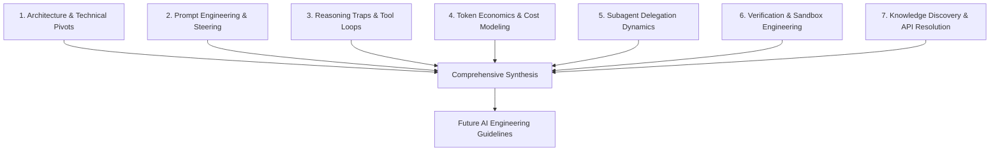
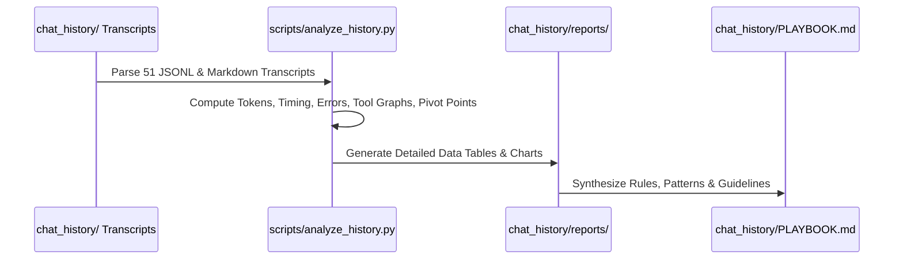

# VSOnDemandSymbols: Development Process Analysis Plan & Preliminary Findings

> **Objective:** Systematically analyze the **50 extension-development conversation transcripts** (`S01–S49`, `S51`), prompt sequences, agent thinking traces, tool actions, and design artifacts in `chat_history/` to understand what worked, what failed, where tokens and time were wasted, how models performed, and how to optimize AI-assisted engineering for future complex software projects. *(The 10 meta sessions `S50`, `S52–S60` dedicated to extracting this history, running the analysis, and building the slide deck are tracked separately in [INDEX.md](INDEX.md) and [summary_metrics.json](summary_metrics.json): 574 turns, 61.54M tokens, $11.34 USD.)*

---

## 1. Executive Summary & Dataset Overview

Building **On-Demand Symbols** (a high-performance Visual Studio extension accelerating Unreal Engine 5 debugging) produced a rich trajectory of agent-pilot collaboration. Spanning **50 chronological development sessions** from **November 5 to November 12, 2026**, the dataset captures the complete lifecycle: specification authoring, subagent exploration of the Unreal Engine codebase, iterative C# VSIX development, test rationalization, performance profiling on Lyra, and multi-instance coordination.

### Dataset Baseline Metrics (Extension Development: `S01–S49`, `S51`)

| Metric | Measured Value |
|---|---|
| **Total Development Sessions** | **50** (43 Interactive User Sessions, 7 Autonomous Subagents) |
| **Total Prompt Input Tokens** | **22,557,447** (~22.6 M tokens) |
| **Total Cached Context Read Tokens** | **468,454,270** (~468.5 M tokens; **95.41% cache hit rate**) |
| **Total Model Output Tokens** | **2,611,132** (~2.6 M tokens) |
| **Total Exact Cost** | **$100.27 USD** *(dynamically calculated per step across all mid-session model switches)* |
| **Meta Sessions (Analysis & Slide Deck)** | **10** (`S50`, `S52–S60`: 5 main, 5 subagents; **574 turns**, **61.54M tokens**, **$11.34 USD**) |
| **Complete Machine-Readable Dataset** | [summary_metrics.json](summary_metrics.json) (100% self-contained in `chat_history/`) |
| **Primary Models Utilized** | **Gemini 3.8 Flash**, **Gemini 4 Argon**, **Claude Opus 5.5**, **Gemini 4 Hydrogen** |
| **Design / Planning Artifacts** | **6** foundational artifacts (`artifacts/`) |

---

## 2. Preliminary Findings from the Data

An initial quantitative scan of the 50 development sessions reveals striking operational patterns:

### 2.1 The "Monster Session" 80/20 Rule
The vast majority of sessions were tight, tactical interactions (1–5 user prompts, 10–50 tool actions, under 5M tokens). However, a small handful of outlier sessions account for the majority of spend and errors—most notably **Session 10** (`$30.93`, 559 tool calls, 100 errors, 2 compactions), **Session 51** (`$19.38`, 543 tool calls, 115 errors, 2 compactions), and **Session 21** (`$1.77` on Flash High, 456 tool calls, 96 errors, 2 compactions):

1. **Session 10 (`7b1b8651` - Phase 3 Implementation):**
   - **1,062 steps**, 20 user prompts, 27 model replies, **559 tool calls**, **100 tool errors**.
   - **63.2M prompt/cache tokens**, 330k output tokens, 229k characters of thinking.
   - **2 Context Compactions (Checkpoints)** occurred.
   - *What happened:* The agent attempted a massive monolithic implementation of symbol include-list management and breakpoint event hooks, repeatedly hitting compilation errors, threading rule violations (`ThreadHelper.ThrowIfNotOnUIThread`), and sandbox pipe deadlocks.
2. **Session 21 (`3b95c335` - Break-Mode Symbol Resolution Bug):**
   - **965 steps**, 25 user prompts, 20 model replies, **456 tool calls**, **96 tool errors**.
   - **60.3M prompt/cache tokens**, 242k output tokens, 162k characters of thinking.
   - **2 Context Compactions**.
   - *What happened:* Debugging why Callstack/Threads symbols failed to load during break mode. The agent entered repetitive loops inspecting DTE thread objects, attempting symbol server masking, running diagnostic logs, and encountering symbol loading COM exceptions.

### 2.2 Model Allocation & Roles in the Wild
Tracking `Model Selection` settings across sessions reveals how model capabilities were matched to tasks:

| Model | Active Sessions | Total Turns | Input Tokens | Cached Tokens | Output Tokens | Exact Cost (USD) |
|---|---|---|---|---|---|---|
| **Claude Opus 5.5 (Medium/High)** | 3 | 64 | 596,698 | 7,831,913 | 150,978 | **$49.65** |
| **Gemini 4 Argon (Medium/High)** | 13 | 804 | 4,857,600 | 97,006,576 | 724,790 | **$38.80** |
| **Gemini 3.8 Flash (High/Medium)** | 44 | 3,821 | 16,776,807 | 363,213,947 | 1,724,141 | **$11.45** |
| **Gemini 4 Hydrogen (Medium)** | 1 | 5 | 326,342 | 401,834 | 11,223 | **$0.38** |
| **Total Development (`S01–S49, S51`)** | **50** | **4,694** | **22,557,447** | **468,454,270** | **2,611,132** | **$100.27** |

- **Claude Opus 5.5:** Reserved for high-abstraction initial specification (Session 01: `docs/SPEC.md`, `AGENTS.md`) and high-level architectural retrospectives/reviews (Session 27). High reasoning depth, structured planning, low hallucination on architectural constraints.
- **Gemini 4 Argon:** Deployed for complex technical investigations, integration test design (MiniUnreal / Lyra profiling in Session 46), and delicate Git/repo initialization (Session 02).
- **Gemini 3.8 Flash:** The workhorse for iterative feature coding, refactoring, documentation synchronization, and fast tool execution loops. Extremely rapid turnaround, but more prone to tool-retry loops when hit with unexpected sandbox or COM errors.

### 2.3 Compaction Induced Thrashing
Six development sessions hit the context boundary and triggered system compactions (`CHECKPOINT`): Sessions **02**, **10**, **21**, **43**, **46**, and **51** (9 compactions total, accounting for **$71.62 / 71.4% of dev spend** and **431 / 44.1% of dev tool errors**).
- In Session 10 and Session 21, once compaction occurred, the agent lost fine-grained memory of prior failed code edits. It occasionally reintroduced patterns the user had already rejected or re-ran diagnostic commands it had already tried 50 turns earlier.
- **Key Observation:** Mega-sessions that cross compaction thresholds have diminishing marginal returns and high token waste compared to fresh, scoped sessions.

---

## 3. Core Analytical Dimensions to Investigate

To extract actionable lessons, we will analyze the transcripts across six core dimensions:

---

### Dimension 1: Architectural Decisions, Pivots, and Dead Ends

We will trace the exact turn-by-turn evolution of technical decisions by comparing conversation discussions against `docs/DECISIONS.md` and `docs/ARCHITECTURE.md`.

#### Key Case Studies to Analyze:
1. **The Concord Debug Engine vs. DTE Decision (ADR-01):**
   - *Question:* Why did early exploration lean towards a native Concord debug engine (`IDebugSymbolSettings`), and at what point in the logs was it rejected in favor of DTE `IncludeList`?
   - *Metrics:* Steps spent investigating Concord vs. steps spent implementing DTE; token expenditure before the pivot.
2. **UBT Manifest Parsing vs. Convention-Based Module Resolution (ADR-03 / ADR-07):**
   - *Question:* Why did the initial idea of parsing `TargetRules` / `ModuleRules` via live MSBuild execution fail, and how did subagents (Sessions 05–09) extract ground truth from `D:\UnrealEngine` to prove regex/convention resolution was sufficient?
3. **Symbol Server Masking & Scoped Local Loading (ADR-08 / ADR-17):**
   - *Question:* Why was symbol loading in break mode so bug-prone (Session 21)? What were the failed implementations (checking PDB existence on disk, file system scraping) before landing on scoped temporary symbol server masking?
4. **Code Rationalization & Dead Code Purges:**
   - *Question:* In Session 13 ("simplify the implementation plan"), Session 28 ("what is polyfills.cs and is it still needed?"), and Session 35 ("unit test rationalization"), how much code generated in earlier sessions was thrown away, and why?

---

### Dimension 2: Prompting Patterns — Effective vs. Failure-Inducing

We will classify all user prompts into archetypes and correlate them with session outcomes (success on turn 1 vs multi-turn debugging loops).

#### Hypothesized Prompt Archetypes:

| Prompt Archetype | Example from History | Observed Outcome |
|---|---|---|
| **Bounded Spec Delegation** | *"As per AGENTS.md, implement Phase 1 of implementation_plan.md..."* (Session 03) | **High Success:** Clear constraints, pre-agreed scope, minimal drift. |
| **Triage / Probing First** | *"Suggest possible solutions for this without implementing them yet"* (Session 21, Prompt 1) | **High Success:** Prevents the agent from writing 500 lines of unvetted code. |
| **Surgical Refactoring** | *"Get rid of static member DebuggerSessionMonitor.BreakpointError"* (Session 22) | **High Success:** 1 turn, clean diff, zero side effects. |
| **Open-Ended Diagnostic** | *"Why are symbols not loading in threads window?"* (Session 21, Prompt 5) | **Mixed / High Token Cost:** Agent generates sprawling diagnostics, checks 124 threads in a loop. |
| **Vague Performance Plea** | *"Anything we can do to speed this up?"* (Session 49) | **Moderate:** Agent suggests broad optimizations, needs tight user steerage. |

#### Analysis Questions:
- What prompt phrasing most effectively stopped the model from over-engineering?
- How did the pilot's negative constraints (*"don't touch symbol servers", "don't implement yet", "don't run sleep"*) impact model safety?
- Did multi-part prompts (asking for 3+ things at once) lead to skipped requirements compared to single-focus prompts?

---

### Dimension 3: Agent Stalling, Confusion, and Tool Loops

We will quantify moments where the AI struggled, repeated actions, or burned cycles.

#### Key Patterns to Quantify:
1. **Compilation & Sandbox Failure Loops:**
   - In Session 10, MSBuild repeatedly failed or hung because worker node reuse (`/nr:true`) or compiler server (`VBCSCompiler`) held named pipes in the sandbox. How many turns did it take for the rule `UseSharedCompilation=false /nr:false` to be institutionalized in `AGENTS.md`?
2. **COM & UI Thread Exception Cascades:**
   - Visual Studio COM calls (`EnvDTE`, `IVsDebugger`) throwing `RPC_E_WRONG_THREAD` or `COMException`. How many turns were spent fixing missing `ThreadHelper.ThrowIfNotOnUIThread()` calls?
3. **Redundant File Reads:**
   - Instances where the agent read the exact same 500-line source file 4 times in a single session instead of remembering its structure.
4. **Deep Thinking Duration vs. Output Value:**
   - Correlating character length of `thinking` blocks with code change quality. Did 5,000-character reasoning traces produce better code than 800-character traces, or did long traces indicate the model was second-guessing itself in circles?
5. **Fresh Session Splits vs. Continuing Existing Sessions:**
   - Was the pilot's decision to start a new session rather than continuing in an existing one effective? Compare short/surgical sessions and deliberate handoffs (e.g., `S14` → `S15`) against long/mega-sessions (`S10`, `S21`) on cost, error rate, and compaction decay.

---

### Dimension 4: Token Economics and Cost Modeling

We will produce an exact accounting of token consumption and cost modeling across all sessions.

#### Pricing Models to Apply:
Using official token rates (standard API pricing per million tokens):

| Model | Input (Uncached) / 1M | Prompt Cache Read / 1M | Output / 1M |
|---|---|---|---|
| **Gemini 3.8 Flash** | \$0.10 | \$0.025 | \$0.40 |
| **Gemini 4 Argon** | \$1.25 | \$0.30 | \$5.00 |
| **Claude Opus 5.5** | \$15.00 | \$3.75 | \$75.00 |

#### Cost Analysis Goals:
1. **Total Estimated Development Cost:** Calculate the exact dollar figure spent building the entire VSIX project from scratch.
2. **Cost per Component/Milestone:**
   - Phase 1 (Core Module Resolution): \$X
   - Phase 2 (Unreal Codebase Verification via Subagents): \$Y
   - Phase 3 & 4 (Debugger Events & Triggers): \$Z
   - Integration Testing & Profiling (MiniUnreal / Lyra): \$W
3. **Prompt Cache Savings:** Calculate how many thousands of dollars prompt caching saved across 409M cached tokens compared to un-cached API calls.
4. **Cost of Errors:** Calculate the direct dollar cost of tool error loops in Sessions 10 and 21.
5. **Effectiveness of Mid-Session Model Switching:** Evaluate all 7 sessions with mid-session model switches (`S03`, `S10`, `S11`, `S27`, `S43`, `S44`, `S51`). Did escalating to Argon or Opus mid-session resolve blockers faster, or did inheriting a bloated context inflate cost without proportionate gain—and what model-routing strategy would have been more effective?

---

### Dimension 5: Subagent Delegation Dynamics

Sessions 05, 06, 07, 08, 09, 25, and 26 were autonomous subagent runs spawned by parent agents.

#### Key Questions:
- **Task Specialization:** Did delegating read-only codebase exploration in `D:\UnrealEngine` to subagents (Sessions 05–09) prevent context window pollution in the parent session?
- **Prompt Precision in Delegation:** Did subagents return concise, structured facts or unstructured dumps?
- **Subagent Success Rate:** How frequently did a subagent return an output that required zero follow-up corrections from the parent?
- **Subagent Utilization & Orchestrator Potential:** Was overall subagent usage effective, and why did subagent delegation drop to zero for coding/investigation after Session 09 (`S10–S51`, except `S25–S26` image generation)? Could an **orchestrator + subagent/swarm** pattern (cheap read-only explorers + scoped implementation/review workers) have prevented mega-sessions like `S10`, `S21`, and `S51`?

---

### Dimension 6: Verification, Testing, and Safe Tooling

How did verification evolve from blind guessing to rock-solid automated suites?

#### Evolution to Analyze:
1. **The "Cannot test VSIX in headless sandbox" hurdle:** Early sessions lacked automated VSIX testing because Experimental instance (`devenv.exe /rootsuffix Exp`) requires Windows Desktop and ROT registration.
2. **The In-Memory Core Test Strategy:** Moving all module resolution and regexes into `VSOnDemandSymbols.Core` (netstandard2.0) with xUnit tests running via `dotnet run --no-build`.
3. **The Breakthrough: Out-of-Sandbox COM Integration Tests (`tests/VSOnDemandSymbols.IntegrationTests`):**
   - Spawning devenv, connecting via ROT COM, driving breakpoints in MiniUnreal and Lyra without pilot intervention.
   - Analyzing Sessions 45–47 where this test harness was designed and verified.

---

### Dimension 7: Knowledge Discovery & API Resolution Strategies

How did the agents actually discover Visual Studio debugger APIs, Unreal Engine rules, and correct fixes—through Microsoft documentation (`search_web`), local DLL reflection/disassembly (`System.Reflection`, `ildasm.exe`), source-code inspection, or trial-and-error?

#### Key Questions:
1. **Channel Mix:** Quantify `search_web` (`learn.microsoft.com`), `.NET Reflection` against VS/NuGet DLLs, `ildasm.exe` disassembly, and edit-compile-fail trial-and-error across all 51 sessions.
2. **Why Agents Preferred DLL Reflection/Disassembly Over Docs:** When did inspecting `Common7\IDE` and `.nuget\packages` assemblies succeed immediately vs. when did missing docs (e.g., Unified Settings `registration.json`) trigger `search_web` + trial-and-error storms?
3. **Actionable Guidance:** How should future AI projects structure local SDK/API inspection tools so agents verify exact signatures on Turn 1 instead of guessing?

---

## 4. Execution Plan & Analysis Pipeline

We will implement this analysis in four structured phases, using custom Python analysis scripts:

### Phase 1: Quantitative Metric Aggregation (Automated Script)
Create a Python script `chat_history/scripts/generate_quantitative_metrics.py` that computes:
- Exact token usage (input, cached, output) per session and per model.
- Financial cost breakdown based on model rate cards.
- Tool invocation frequencies and error rates per tool (`run_command`, `read_file`, `write_file`, `edit_file`).
- Duration and thinking character metrics per turn.
- Compaction and context overflow metrics.

### Phase 2: Qualitative Deep-Dive into Key Pivot Sessions
Perform a forensic review of the 10 pivotal sessions:
- **Session 01:** Initial Project Brief & Architecture Formulation (Claude Opus 5.5).
- **Session 04 & 05–09:** Phase 2 Unreal Codebase Subagent Delegation.
- **Session 10:** Phase 3 Monster Session (Implementation & Tool Loop Analysis).
- **Session 13:** The Simplification Pivot (cutting scope, pruning unnecessary features).
- **Session 21:** Break-Mode Debugging Monster Session (DTE Callstack & Symbol Loading).
- **Session 24–26:** Multi-Agent Icon Ideation & Generation.
- **Session 28 & 35:** Code Review, Polyfill Removal, and Unit Test Rationalization.
- **Session 43:** Full Codebase Review and Simplification.
- **Session 45 & 46:** Integration Test Architecture (MiniUnreal / Lyra Profiling).
- **Session 51:** Multi-Instance VS Race Condition Identification.

### Phase 3: Error Pattern & Failure Taxonomy
Categorize every single tool failure (978 total failures across the 50 development sessions) into:
- Sandbox boundary failures (network, file permissions, named pipes).
- Visual Studio COM / Threading violations.
- Compilation / MSBuild errors.
- Hallucinated paths or API assumptions.
- Flaky / non-deterministic integration test timeouts.

### Phase 4: Synthesis into "The Antigravity Engineering Playbook"
Produce the ultimate user-facing deliverable: `chat_history/PLAYBOOK.md` — an actionable engineering guide for future AI-driven software development projects covering:
- **Model Selection Guide:** Which model to assign to architecture vs implementation vs debugging vs testing.
- **Context Management Rules:** When to kill a session and start fresh to avoid compaction decay.
- **Prompt Engineering Templates:** Verified prompt templates for code spikes, bug fixes, refactoring, and spec generation.
- **Sandbox-Proof Development Architecture:** Structuring projects so 95% of logic can be validated inside sandboxed fast tests.

---

## 5. Next Immediate Step

To begin execution of this plan, we can now write and run the Phase 1 script (`chat_history/scripts/generate_quantitative_metrics.py`) to generate the complete financial, token, tool error, and timing breakdown across all 51 sessions.
