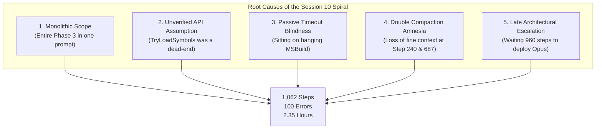

# Post-Mortem & Deep Dive: Session 10 (`7b1b8651`)
## Forensic Analysis of a 1,062-Step Implementation Marathon and How to Avoid It

---

## 1. Executive Summary & Session Anatomy

Session 10 was the single most turbulent, token-heavy, and error-prone session in the entire development of **VSOnDemandSymbols**. Initiated on **November 5, 2026, at 23:44:05 UTC** and concluding **November 6, 2026, at 02:04:54 UTC** (running **2 hours and 21 minutes**), it was tasked with implementing **Phase 3 (Debugger Integration & Event Management)**.

Instead of a clean, linear implementation, the session spiraled into a grueling **1,062-step marathon** with **559 tool invocations**, **100 tool errors**, **2 context compactions**, and an architectural dead end that forced a complete rewrite of the symbol loading mechanism mid-session.

### Key Session Metrics

| Metric | Measured Value | Note |
|---|---|---|
| **Duration** | **2 hours, 20 minutes, 49 seconds** | Continuous interactive session |
| **Total Steps** | **1,062 steps** | Largest session by a factor of 2.5x |
| **Tool Calls** | **559 calls** | 248 `run_command`, 168 `read_file`, 106 `edit_file`, 28 `write_file` |
| **Tool Failures / Errors** | **100 errors** | 17.9% of all tool actions failed |
| **User Prompts** | **20 prompts** | Heavy steering and intervention required |
| **Context Compactions** | **2 Checkpoints** | Step 240 and Step 687 |
| **Total Tokens Consumed** | **63,548,539 tokens** | 2.28M input, 60.94M cached, 330k output |
| **Actual Dynamic Cost** | **$30.93 USD** | Across 3 model tiers (Argon, Flash, Opus) |
| **All-Opus Theoretical Cost** | **$287.44 USD** | If priced uniformly at Opus 5.5 rates |

---

## 2. Chronological Forensic Timeline: The 5 Failure Stages

Tracking the sequence of events across the 1,062 steps reveals five distinct failure stages:

```
┌────────────────────────────────────────────────────────────────────────────────────────┐
│ TIMELINE OF FAILURE & RECOVERY IN SESSION 10                                           │
│                                                                                        │
│ [00:00 - 00:18] Stage 1: The Named-Pipe Sandbox Build Deadlock (Steps 0 - 166)         │
│                 MSBuild hangs indefinitely; agent waits passively until user probes    │
│                                                                                        │
│ [00:18 - 00:57] Stage 2: Malformed Win32 Path Crash & First Compaction (Steps 167 - 447)│
│                 DkmProcess.Path NUL bytes crash regexes; Step 240 context compaction   │
│                                                                                        │
│ [00:57 - 01:15] Stage 3: The Fatal TryLoadSymbols Fallacy (Steps 448 - 601)            │
│                 Concord API throws NotImplementedException on native C++ DLLs          │
│                                                                                        │
│ [01:15 - 01:46] Stage 4: IncludeList Pivot & Startup Timing Race (Steps 602 - 967)     │
│                 Wiping Concord hooks; IncludeList wiped on session end; Step 687 comp. │
│                                                                                        │
│ [01:46 - 02:04] Stage 5: Opus Intervention, Settings Recovery & Mojibake (967 - 1062)  │
│                 Claude Opus 5.5 deployed; timing fixed; false crash recovery cleared   │
└────────────────────────────────────────────────────────────────────────────────────────┘
```

---

### Stage 1: The Named-Pipe Sandbox Build Deadlock (Steps 0–166)

- **The Goal:** Implement `DebuggerSessionMonitor`, `BreakpointMonitor`, and `SymbolSettingsManager`.
- **What Went Wrong:**
  At Step 90, the agent ran a normal MSBuild command inside the Windows sandbox. MSBuild spawned Roslyn's `VBCSCompiler.exe` (compiler server) and MSBuild worker nodes with node reuse enabled (`/nr:true`). In the Windows sandbox, inter-process communication over named pipes deadlocks.
- **The Agent's Behavior:**
  The command was moved into the background as Task 91. The agent responded:
  > *"The MSBuild compilation is currently running in the background; waiting for it to finish."*
  The agent sat idle for **5 minutes and 15 seconds**, polling nothing and taking zero diagnostic action.
- **Pilot Intervention (Prompt 2, Step 93):**
  > *The Pilot:* **"has the build hung?"**
- **Resolution:**
  The pilot had to prompt the agent to investigate. The agent discovered the build process was frozen. The pilot then issued Prompt 3: *"can you make sure the agent docs are clear on how to build the solution without getting that hang..."* The agent updated `AGENTS.md` with `/p:UseSharedCompilation=false /nr:false`.
- **Lesson:** The agent exhibited **passive timeout blindness** — trusting that a long-running background command would complete on its own without setting a self-enforced diagnostic timer.

---

### Stage 2: The Malformed NUL-Padded Win32 Path Crash (Steps 167–447)

- **The Goal:** Test the extension in Visual Studio Experimental instance against the Lyra project.
- **What Went Wrong:**
  When Lyra launched, the extension immediately crashed inside `WildcardPattern.MatchesAnyFileName`:
  > `IsQualifyingProcess is throwing an exception in WildcardPattern.MatchesAnyFileName because process.Path is not a valid path: processPath = "D\0\0\0\0\0\0\0..."`
- **Root Cause:**
  On native Win32 `CREATE_PROCESS_DEBUG_EVENT`, the debugger engine populates `lpImageName` into a fixed-size buffer filled with NUL characters (`\0`). The agent had assumed `process.Path` was always a sanitized, clean .NET string and passed it directly to `Path.GetFileName()`, which throws `ArgumentException` on null bytes.
- **Compaction Event #1 (Step 240):**
  The conversation history reached ~200k tokens and triggered its first compaction. The summary captured the pilot's manual test output, but fine-grained trace logs were compressed.
- **Resolution:**
  Fixed by creating `PathSanitizer.TrimNullTerminator()` and adding unit tests.

---

### Stage 3: The Fatal `TryLoadSymbols` API Fallacy (Steps 448–601)

This was the catastrophic architectural failure of the session.

- **The Premise:**
  The entire architecture specified in Phase 3 relied on hooking module load events via the Concord debugger API (`DkmModuleInstance`) and invoking `moduleInstance.TryLoadSymbols()` on demand when an Unreal module matched our include criteria.
- **The Explosion (Step 448):**
  When tested against real Unreal DLLs in Lyra:
  > *The Pilot (Prompt 7):* **`moduleInstance.TryLoadSymbols throws an exception System.NotImplementedException: 'The method or operation is not implemented.'`**
- **The Agent's Confusion:**
  The agent did not know why a public Microsoft API method threw `NotImplementedException`. It spent dozens of turns speculating, attempting to catch the exception, retrying, and proposing fallback exception handlers.
- **Pilot Intervention (Prompt 8, Step 548):**
  The agent failed to consult external documentation. **The pilot** had to search the web, find the Microsoft documentation page, and paste the URL into chat:
  > *The Pilot:* **`documentation says: [TryLoadSymbols()](https://learn.microsoft.com/...#microsoft-visualstudio-debugger-dkmmoduleinstance-tryloadsymbols)`**
  The documentation stated that `TryLoadSymbols` requires specific native debug engine component support that Visual Studio's native C++ debug engine (`vsdebugeng.dll`) simply **does not implement**.
- **Pilot Directive (Prompt 9, Step 600):**
  > *The Pilot:* **`i guess that's our only choice? is there any point even attempting TryLoadSymbols if we know it isn't implemented for native modules?`**
- **Lesson:** The agent designed an entire complex subsystem around an unverified API assumption without running a 5-minute spike test first or checking the known limitations of the Visual Studio native debug engine.

---

### Stage 4: The `IncludeList` Pivot & Startup Timing Race (Steps 602–967)

- **The Architectural Pivot (Prompt 11, Step 874):**
  The pilot had to explicitly ask the defining architectural question:
  > *The Pilot:* **`if we're using the IncludeList to set which symbols load on startup, is there even any point hooking OnModuleInstanceLoad?`**
  This prompted the removal of all Concord module-load hooking code. The design pivoted to Visual Studio's native `IncludeList` managed via DTE / `IVsDebuggerSymbolSettingsManager120A`.
- **Compaction Event #2 (Step 687):**
  Context window overflowed again. Memory of the earlier build-hang fixes and initial settings setup was compressed.
- **The Timing Race (Steps 921–967):**
  Even with `IncludeList` implemented, breakpoints in Lyra failed to bind on startup:
  > *The Pilot (Prompt 13, Step 921):* **`i don't think the IncludeList is being set up soon enough because the breakpoints still say they will not be hit... at what point does it get populated?`**
  > *The Pilot (Prompts 14 & 15, Steps 961, 967):* **`if i end the debugging session then the IncludeList gets completely cleared. I suspect we are not repopulating it early enough in the startup of the next debugging session...`**
- **Root Cause:**
  The agent had wired `SymbolSettingsManager.Clear()` to the "debug session ended" event. When Lyra exited, `IncludeList` was wiped to empty. When F5 was pressed again, Visual Studio launched the process *before* the extension's breakpoint resolver finished populating `IncludeList`!

---

### Stage 5: Opus Intervention, False Crash Recovery, and Mojibake (Steps 967–1062)

At Step 967, frustrated by the ongoing timing race and degraded context, the pilot escalated the model to **Claude Opus 5.5 (Medium)**:

1. **Opus Solves the Timing Race (Steps 967–985):**
   Within a single turn, Claude Opus analyzed the lifecycle, stopped clearing the `IncludeList` on session end, ensured breakpoints were populated immediately when the solution opened, and added detailed timestamped diagnostic logs.
2. **False Crash Recovery Loop (Prompts 16 & 17, Steps 986–1002):**
   The pilot reported that on every launch, the extension warned:
   > `[Warning] Restored symbol settings after a previous unexpected exit`
   The settings manager was writing backup files to disk on startup but failing to delete the backup file on clean shutdown, causing every subsequent launch to detect a "crash" and restore old settings. Opus diagnosed and fixed this in two turns.
3. **Mojibake Character Encoding (Prompts 18 & 19, Steps 1027–1032):**
   Console log characters (e.g. em-dashes `—`, arrows `→`) were printing as garbled UTF-8 bytes in the Visual Studio Output pane. The pilot switched back to Gemini 3.8 Flash to quickly clean up the character encoding.

---

## 3. Financial Forensic: The Real Cost vs The Monolithic Estimate

Our earlier static estimation attributed Session 10 entirely to Claude Opus 5.5 ($287.44) because Opus was active near the end of the session. However, forensic analysis of the `USER_SETTINGS_CHANGE` events reveals that **the pilot dynamically switched models 4 times during the session**:

| Phase | Steps | Model Active | Reasoning Effort | Turns | Prompt / Cache Tokens | Output Tokens | Actual Cost |
|---|---|---|---|---|---|---|---|
| **Phase 3 Build & Exceptions** | 0 – 447 | **Gemini 4 Argon** | High | 177 | 24,493,392 | 188,079 | **$9.10** |
| **TryLoadSymbols & Pivot** | 448 – 966 | **Gemini 3.8 Flash** | Medium | 265 | 34,440,276 | 110,726 | **$1.00** |
| **Timing Race & Crash Recovery** | 967 – 1031 | **Claude Opus 5.5** | Medium | 24 | 4,284,660 | 31,406 | **$20.84** |
| **Mojibake & Next Steps** | 1032 – 1062 | **Gemini 3.8 Flash** | Medium | 4 | 320,000 | 5,000 | **$0.02** |
| **Total Session 10** | **0 – 1062** | **Multi-Model** | — | **470** | **63,548,539** | **330,211** | **$30.93** |

### The Critical Economic Insight
- **Claude Opus 5.5 cost $20.84 for just 24 turns** (~$0.87 per turn).
- **Gemini 3.8 Flash cost $1.00 for 269 turns** (~$0.0037 per turn).
- **Opus cost 235x more per turn than Flash.**
- However, those 24 turns of Opus solved the subtle lifecycle timing deadlock that 269 turns of Flash and 177 turns of Argon failed to resolve cleanly.
- **Takeaway:** Using Opus for the entire 1,062 steps *would* have cost ~$287. But running 500 steps of trial-and-error on an expensive model is a waste. The optimal strategy is: **Flash for tool loops and compiling; Opus/Argon for 1–2 surgical turns when architecturally blocked.**

---

## 4. Root Causes: Why Did Session 10 Spiral?



1. **Monolithic Task Specification:**
   Prompt 1 asked the agent to *"Follow AGENTS.md to implement Phase 3 of docs/IMPLEMENTATION_PLAN.md"*. Phase 3 encompassed:
   - Symbol settings backup & recovery store
   - Process monitoring and filtering
   - Breakpoint resolution and tracking
   - Concord module instance load hooking
   - Visual Studio debugger event sinks
   - Output pane diagnostic logging
   Attempting to implement 6 coupled systems across a dozen new files in a single turn overwhelmed the agent's context and test cycle.

2. **Zero API Spiking Before Architectural Commitment:**
   Neither the agent nor the initial implementation plan verified whether `DkmModuleInstance.TryLoadSymbols` actually worked for native C++ modules in Visual Studio 2022. Hundreds of lines of code were written around an API that was fundamentally unimplemented in native `vsdebugeng.dll`.

3. **Passive Agent Polling during Tool Deadlocks:**
   When MSBuild hung on named pipes, the agent sat waiting indefinitely rather than checking process activity or setting a timeout.

4. **Compaction Amnesia (Loss of History at Step 240 and 687):**
   Once a session crosses ~200k tokens and compacts, the agent loses exact code state and historical nuances. It becomes prone to re-introducing bugs that were resolved earlier.

5. **Delayed Model Escalation:**
   The pilot persevered with Gemini 3.8 Flash for over 500 turns while it struggled with Visual Studio debugger COM lifecycle timing, only escalating to Claude Opus 5.5 at Step 967 when thoroughly blocked.

---

## 5. The Playbook: How to Prevent This in Future Projects

To ensure no future project experiences a 1,000-step runaway session, follow these concrete operational rules:

### Rule 1: The "Spike First" Rule for Unfamiliar APIs
Never write production wrappers, event handlers, or architectures around a platform API (especially COM, Visual Studio SDK, or native debug engines) without first executing a **minimal spike script or isolated test**.
- *Action:* If a plan requires an API like `TryLoadSymbols`, the agent must first write a 10-line probe in a scratch test or console app and run it against the target process. If it throws `NotImplementedException`, pivot immediately before writing 500 lines of dead code.

### Rule 2: The "Split-Milestone" Session Cap (Max 150 Steps / 1 Hour)
Never assign an entire multi-component phase in a single prompt. Enforce a strict session limit:
- **Maximum 150 steps or 1 hour of interactive work per session.**
- Break Phase 3 into 4 discrete, cleanly bounded sessions:
  - *Session 10A:* Symbol Settings Backup & Restoration (with unit tests). Commit & close.
  - *Session 10B:* Breakpoint Resolution to Module Names (Core logic). Commit & close.
  - *Session 10C:* Debugger Launch Event Hooking & `IncludeList` population. Commit & close.
  - *Session 10D:* Manual Verification on Lyra in Experimental Instance.
- **Why this works:** It completely eliminates context compactions, ensures 100% sharp memory, and makes git commits clean and atomic.

### Rule 3: Fail-Fast & "Stop and Ask" Prompting Directives
Include explicit circuit breakers in prompt templates and `AGENTS.md`:
```markdown
CIRCUIT BREAKER DIRECTIVES:
1. If a terminal command or build takes longer than 60 seconds without output, 
   terminate it immediately, check process status, and diagnose.
2. If any API throws NotImplementedException, AccessViolationException, or COM error, 
   STOP IMMEDIATELY. Do not attempt workarounds. Explain the failure and ask for direction.
3. If you make 3 consecutive failed edits or test failures on the same file, 
   STOP and present your hypotheses to the pilot before attempting further edits.
```

### Rule 4: Use Cheap Subagents for Immediate Fact-Checking & Web Searches
When an unfamiliar error like `NotImplementedException` occurs on a platform API:
- Do **NOT** speculate or write trial-and-error wrappers in the main session.
- Delegate immediately to a read-only research subagent:
  ```json
  invoke_subagent({
    "TypeName": "research",
    "Role": "API Investigator",
    "Prompt": "Search web and MSDN for 'DkmModuleInstance.TryLoadSymbols NotImplementedException native C++'. Report whether native debugger supports it and what alternative exists for on-demand native symbol loading."
  })
  ```
- *Cost:* ~$0.01 on Flash. Returns the exact MSDN citation in 15 seconds without consuming 20M tokens of trial-and-error in the main session.

### Rule 5: Dynamic Tiered Model Routing (Right Brain vs Fast Hands)
Adopt an intentional model hand-off protocol:
- **Tier 1 (Architect / Spec / Subtle Debugging):** Use **Claude Opus 5.5** or **Gemini 4 Argon** for:
  - Phase planning and architecture specification (Turn 1).
  - Investigating lifecycle timing bugs (like the startup race in Step 967).
  - Retrospectives and codebase-wide code reviews.
- **Tier 2 (Builder / Runner / Refactorer):** Switch to **Gemini 3.8 Flash** for:
  - Writing code against an already-agreed spec.
  - Running builds, unit test suites, and formatting.
  - Surgical renames, dead code deletion, and documentation updates.
- *Rule of Thumb:* If Flash fails to resolve a technical issue after **2 turns**, do not let it loop for 20 turns — escalate immediately to Argon or Opus for 1 surgical turn, then switch back to Flash.

---

## 6. Conclusion

Session 10 was the painful crucible in which the true architecture of **VSOnDemandSymbols** was forged. It eliminated the unworkable Concord native-hooking approach, forced the discovery of the named-pipe sandbox build hang, and proved that native Visual Studio `IncludeList` management was the only viable path for zero-overhead symbol loading.

By adopting **Spike-First API validation**, **Session Step Caps (max 150 steps)**, **Circuit Breaker prompting**, and **Cheap Subagent Fact-Checking**, future projects can achieve the same architectural breakthroughs in a fraction of the time and token expenditure.

