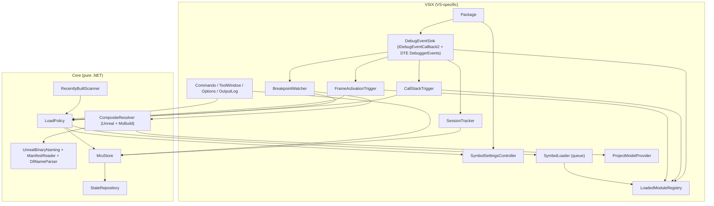
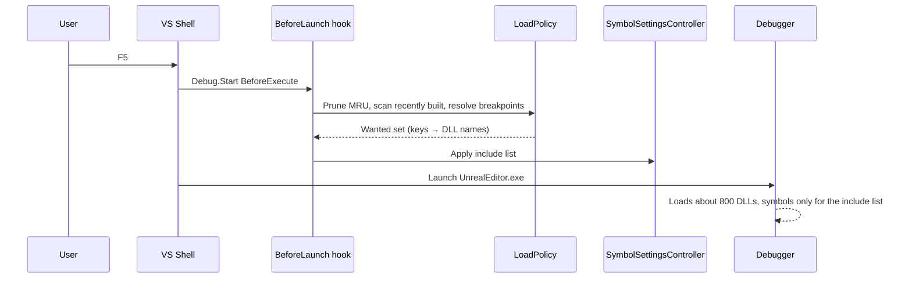
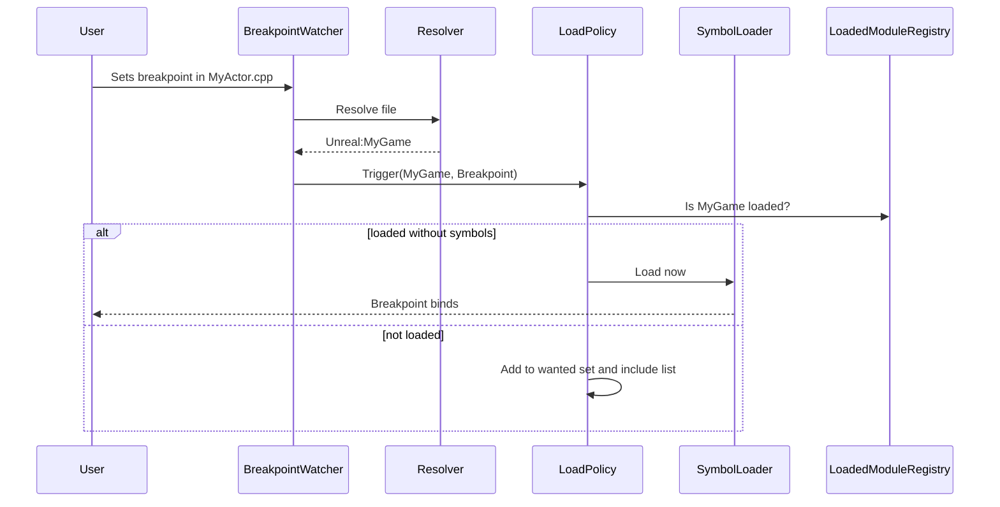

# Architecture

## 1. Solution layout (target)

```
VSOnDemandSymbols/
├─ AGENTS.md
├─ VSOnDemandSymbols.slnx
├─ docs/                                  # spec and design docs (this folder)
├─ src/
│  ├─ VSOnDemandSymbols/                  # VSIX package (net472). VS-specific code only.
│  │  ├─ VSOnDemandSymbolsPackage.cs
│  │  ├─ source.extension.vsixmanifest
│  │  ├─ VSOnDemandSymbols.vsct           # commands, menus, toolbar
│  │  ├─ Commands/                        # Toggle, Pin, LoadNow, ShowToolWindow
│  │  ├─ Debugger/                        # AD7/DTE integration (see §3)
│  │  ├─ Projects/                        # IProjectModelProvider implementation (DTE/VCProjectEngine)
│  │  ├─ Options/                         # DialogPage
│  │  ├─ ToolWindow/                      # WPF tool window + view model
│  │  └─ Logging/                         # Output window pane logger
│  └─ VSOnDemandSymbols.Core/             # netstandard2.0. NO Visual Studio references.
│     ├─ Modules/                         # ModuleKey, resolvers, Unreal naming, manifests, DLL parser
│     ├─ Policy/                          # LoadPolicy, TriggerReason, WildcardPattern
│     ├─ Mru/                             # MruStore, pruning rules
│     ├─ State/                           # JSON state repository, schema, atomic writes
│     └─ Abstractions/                    # IClock, IFileSystem, ILogger, IProjectModelProvider
└─ tests/
   ├─ VSOnDemandSymbols.Core.Tests/       # xUnit (net8.0 + net472), fixture trees, golden tests
   └─ Samples/NativeSample/               # small exe + dll + static lib solution for manual testing
```

The existing blank project currently sits at the repo root. Phase 1 moves it to `src/VSOnDemandSymbols/` and updates the `.slnx`.

**Rule:** anything that can be unit-tested without VS goes in Core. The VSIX project is a thin adapter.

## 2. Component diagram



## 3. Components

| Component | Responsibility | Thread |
|---|---|---|
| `VSOnDemandSymbolsPackage` | Async background load; builds the object graph; subscribes to solution events; crash-recovery restore at startup. | Background, then UI for service access |
| `SymbolSettingsController` | Back up, apply and restore VS symbol settings (SPEC §7.4, §9.2). Single owner of all writes to symbol settings. Idempotent. | UI |
| `DebugEventSink` | Receives AD7 events and DTE debugger events, classifies them, and dispatches typed events. Does no work itself. | UI (callbacks) |
| `SessionTracker` | Session start/end, qualification (SPEC §7.3), run counting, `LastSessionStartUtc`. | UI |
| `LoadedModuleRegistry` | For each process: loaded modules → (`IDebugModule2`, path, `ModuleKey?`, symbol state). Reverse-maps each module to a key once, at load. | UI |
| `SymbolLoader` | De-duplicating queue of load requests (key + reason). Calls `IDebugModule3.LoadSymbols`, tracks the result, and logs. Never loads the same module twice per session. | UI for COM calls, scheduled through JTF |
| `BreakpointWatcher` | Detects breakpoint changes (strategy per spike S4), resolves files to keys, raises `Breakpoint` triggers. | UI for DTE, background for resolution |
| `CallStackTrigger` / `FrameActivationTrigger` | SPEC §5.2 and §5.3. | UI for enumeration, async |
| `RecentlyBuiltScanner` (Core) | Stats DLLs/PDBs in the binaries folders against the reference time; applies the mass-rebuild guard. | Background |
| `LoadPolicy` (Core) | Computes the wanted set (SPEC §5.7) and answers "should module X load?" for a reason; applies the always/never patterns. | Any (immutable snapshots) |
| `MruStore` (Core) | Hits, run increments, pruning, pin/forget. | Any (locked) |
| `StateRepository` (Core) | Load/save of `state.json` with atomic writes and schema versioning. | Background |
| `CompositeResolver` (Core) | Source file → keys (MODULE_RESOLUTION.md). Cached. | Background |
| `ProjectModelProvider` (VSIX) | Exposes solution/project info (TargetPath, project membership, static-lib references) to Core through `IProjectModelProvider`. Snapshots are built on the UI thread and then used from any thread. | UI to build, any to read |
| `OutputLog` | `ILogger` implementation that writes to the "On-Demand Symbols" output pane; level filter. | Any (marshals) |

## 4. Key sequences

### 4.1 Launch (F5)



### 4.2 Breakpoint set while running



## 5. Cross-cutting rules

- **Threading:** follow the VS threading rules. Use `JoinableTaskFactory`, `ThreadHelper.ThrowIfNotOnUIThread()` in every method that touches COM/DTE, and no `.Result` / `.Wait()`. Do file I/O on background threads through `TaskScheduler.Default`.
- **Fault isolation:** wrap every event handler in try/catch → log. A failure in a trigger must never stop other triggers or the debug session (NF-5).
- **Testability:** time through `IClock`, the file system through an `IFileSystem` abstraction (or `System.IO.Abstractions`), logging through `ILogger`. No static state in Core.
- **Dependencies:** prefer what VS already ships (Newtonsoft.Json, Microsoft.VisualStudio.Threading). Don't bundle assemblies VS provides. Core references only netstandard2.0-compatible packages.

