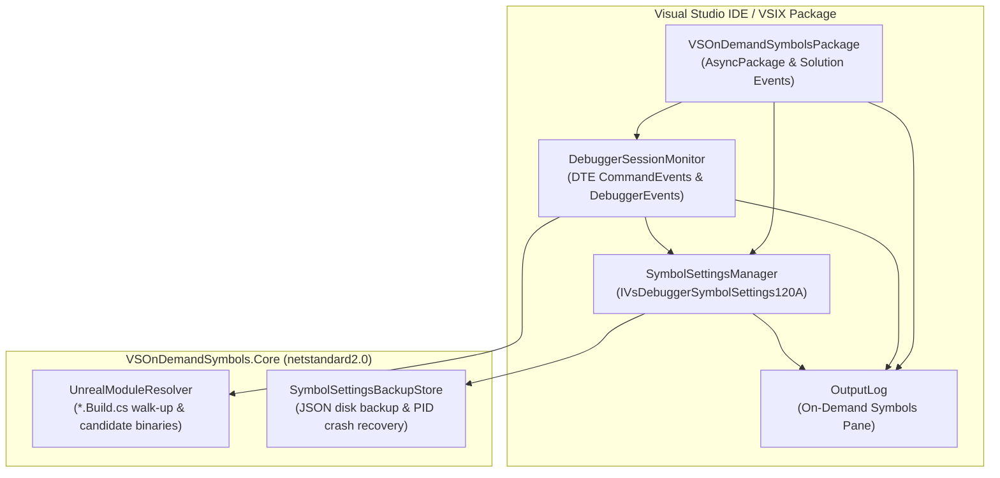
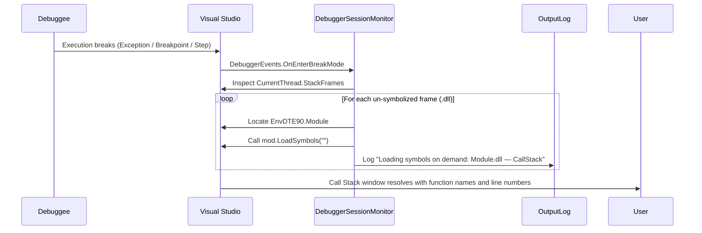

# Architecture — On-Demand Symbols

## 1. Solution Overview

**On-Demand Symbols** is a lightweight, zero-maintenance Visual Studio extension designed specifically to speed up debugging large native Unreal Engine 5 applications (ballpark ~1,000 DLLs).

The solution contains two projects and only **6 core source files**:

```
VSOnDemandSymbols/
├── AGENTS.md                               # AI agent guide and build conventions
├── VSOnDemandSymbols.slnx                  # Solution file
├── docs/                                   # Architectural and design documentation
│   ├── ARCHITECTURE.md                     # This document (system architecture & design rationale)
│   ├── DECISIONS.md                        # Architecture Decision Records (ADR)
│   ├── MANUAL_VERIFICATION.md              # Manual test procedures in Experimental instance
│   ├── MODULE_RESOLUTION.md                # Unreal module naming and resolution reference
│   └── SPEC.md                             # Architectural and functional specification
│
├── src/
│   ├── VSOnDemandSymbols.Core/             # netstandard2.0 (Pure .NET, zero VS dependencies)
│   │   ├── Abstractions/                   # IFileSystem, ILogger, IClock
│   │   ├── Modules/
│   │   │   └── UnrealModuleResolver.cs     # *.Build.cs directory walk-up & candidate DLL generator
│   │   ├── Policy/
│   │   │   ├── BreakSymbolLoadMode.cs      # Break-mode symbol load policy (Off, LocalOnly, All)
│   │   │   └── WildcardPattern.cs          # Path sanitization & wildcard matching
│   │   └── State/
│   │       ├── SymbolSettingsBackupDto.cs  # Backup DTO schema
│   │       └── SymbolSettingsBackupStore.cs# JSON persistence & PID crash recovery
│   │
│   └── VSOnDemandSymbols/                  # net472 (Thin VS adapter, standard NuGet references)
│       ├── VSOnDemandSymbolsPackage.cs     # AsyncPackage, UI context auto-load, lifecycle
│       ├── UnifiedSettings/
│       │   └── registration.json           # Modern Unified Settings manifest (Debugging -> Symbols)
│       ├── Debugger/
│       │   ├── IVsDebuggerSymbolSettings161.cs # COM interop for UseNugetSymbolServers
│       │   ├── IVsDebuggerSymbolSettings170.cs # COM interop for AutomaticSymbolLoad
│       │   ├── SymbolSettingsManager.cs    # Reads/writes IVsDebuggerSymbolSettings120A & disk backup
│       │   └── DebuggerSessionMonitor.cs   # BeforeExecute (F5) hook, Breakpoints, OnEnterBreakMode
│       └── Logging/
│           └── OutputLog.cs                # "On-Demand Symbols" Output pane logger
│
└── tests/
    └── VSOnDemandSymbols.Core.Tests/       # xUnit / In-process test runner with FakeUnrealProject
```

---

## 2. Component Diagram & Responsibilities



### Component Responsibilities

| Component | Project | Responsibility | Primary APIs Used |
|---|---|---|---|
| **`VSOnDemandSymbolsPackage`** | VSIX | Background package initialization, UI context auto-load on C++ solutions, solution open/close listener. | `AsyncPackage`, `IVsSolutionEvents` |
| **`SymbolSettingsManager`** | VSIX | Single point of contact for symbol settings. Backs up original settings before any modification; applies manual-load mode (`IsManualLoad=true`, `IsLoadAdjacent=false`, `AutomaticSymbolLoad=false`); merges breakpoint module binaries into `IncludeList`; cleanly restores original settings on close, disable, or crash recovery. | `IVsDebuggerSymbolSettingsManager120A`, `IVsDebuggerSymbolSettings170` |
| **`DebuggerSessionMonitor`** | VSIX | Subscribes to `DTE.CommandEvents` before launch (F5) to resolve breakpoints (both enabled and disabled, ADR-03) and update `IncludeList`. Observes AD7 `IDebugBreakpointErrorEvent2` to load symbols on demand when breakpoints are added while running. Subscribes to `DTE.DebuggerEvents.OnEnterBreakMode` to inspect call-stack frames and load missing symbols on demand. | `EnvDTE80.DTE2`, `CommandEvents`, `DebuggerEvents`, `IDebugEventCallback2`, `EnvDTE90.Module` |
| **`UnrealModuleResolver`** | Core | Resolves source files to module names by walking up the directory tree to find `{Module}.Build.cs` (handling intermediate UHT and unity paths). Generates candidate DLL names (`UnrealEditor-{Module}*.dll`). Detects Unreal solutions (`*.uproject` or `Engine/Build/Build.version`). | `IFileSystem`, `ConcurrentDictionary` cache |
| **`SymbolSettingsBackupStore`** | Core | Serializes symbol settings backups to `%LOCALAPPDATA%/OnDemandSymbols/<VS_INSTANCE>/symbol-settings-backup.json`. Checks PID on startup to detect and recover from previous Visual Studio crashes. | `Newtonsoft.Json`, `IFileSystem` |
| **`OutputLog`** | VSIX | Thread-safe logger outputting to the dedicated "On-Demand Symbols" pane in the Visual Studio Output window. | `IVsOutputWindowPane` |

---

## 3. Why Concord, MSBuild, and MRU Were Eliminated

During initial exploration (Phases 0–4), three complex subsystems were evaluated and subsequently removed. Their elimination is documented in [DECISIONS.md](DECISIONS.md).

### 3.1 Why Concord Was Eliminated
* **The Premise:** Concord (`Microsoft.VisualStudio.Debugger.Engine`) was initially considered to intercept DLL loads via `IDkmModuleInstanceLoadNotification` and call `moduleInstance.TryLoadSymbols()` synchronously off the UI thread without touching `IncludeList`.
* **The Reality:**
  1. **`TryLoadSymbols` is unsupported for native C++:** In Visual Studio, `DkmModuleInstance.TryLoadSymbols()` throws `NotImplementedException` (`0x80004001` / `E_NOTIMPL`) for native C++ modules. Visual Studio's native debug engine (`CppDebug.dll`) does not implement `IDkmSymbolLocator`.
  2. **Breakpoint glyph corruption:** Implementing Concord's `IDkmBreakpointManagerNotification` interfered with the AD7 event pipeline, causing breakpoint glyphs in the editor margin to remain hollow ("symbols not loaded") even when symbols had been successfully loaded.
  3. **Build & packaging overhead:** Concord required private IDE assembly references (`Microsoft.VisualStudio.Debugger.Engine.dll`), custom MSBuild targets (`Microsoft.VSSDK.Debugger.VSDConfigTool.targets`), `vsdconfigtool.exe`, `.vsdconfigxml` configuration files, and `DebuggerEngineExtension` VSIX assets.
* **The Solution:** Visual Studio's native debug engine automatically checks `IVsDebuggerSymbolSettings120A.IncludeList` during module mapping when manual mode is active. Mid-session loads are handled directly via standard DTE `Module.LoadSymbols("")`. Concord was completely stripped.

### 3.2 Why MSBuild Project Crawling Was Eliminated
* **The Premise:** An MSBuild project crawler (`MsBuildResolver`, `ProjectModelProvider`, `VCProjectEngine`) was initially built to support generic non-Unreal C++ solutions (`Scope = AllNative`).
* **The Reality:** Standard non-Unreal C++ solutions typically contain only a handful of DLLs and do not suffer from the ~1,000-DLL startup problem. Crawling MSBuild project dependency graphs introduced ~700 lines of complex COM interop, potential UI-thread deadlocks, and solution evaluation overhead.
* **The Solution:** Non-Unreal solutions are declared out of scope. When a non-Unreal solution is opened, the extension remains completely inert. For Unreal solutions, directory walk-up to `*.Build.cs` resolves modules in `< 1 ms`.

### 3.3 Why MRU, Pinning, and Persistent State Were Eliminated
* **The Premise:** An MRU (Most Recently Used) cache and module pinning list were proposed to persist previously symbolized modules across debugging runs into `.vs/state.json`.
* **The Reality:** On-demand symbol loading during break mode is fast (~100 ms). Carrying forward modules across sessions caused the `IncludeList` to bloat over time, steadily eroding the startup speedup that the extension exists to provide.
* **The Solution:** The `IncludeList` is populated before launch solely for modules with breakpoints, both enabled and disabled (plus `UnrealEditor.exe` and `UnrealEditor-Win64-*.exe`, ADR-03). No session history or per-solution state files are maintained.

---

## 4. Key Execution Sequences

### 4.1 Launch (F5) with Breakpoints

```mermaid
sequenceDiagram
    participant User
    participant VS as Visual Studio
    participant DSM as DebuggerSessionMonitor
    participant UMR as UnrealModuleResolver
    participant SSM as SymbolSettingsManager
    participant Dbg as Native Debug Engine

    User->>VS: Press F5 (Launch)
    VS->>DSM: CommandEvents.BeforeExecute (cmdidStart)
    DSM->>VS: Query active breakpoints (DTE.Debugger.Breakpoints)
    loop For each breakpoint
        DSM->>UMR: ResolveModuleFromSource(bp.File)
        UMR-->>DSM: Return module name (e.g. MyGame)
        DSM->>UMR: GetCandidateBinaries("MyGame")
        UMR-->>DSM: UnrealEditor-MyGame*.dll
    end
    DSM->>SSM: ApplyManualMode(wantedBinaries)
    SSM->>VS: Write to IncludeList & SaveSymbolSettings()
    VS->>Dbg: Launch UnrealEditor.exe
    loop For each of ~1,000 DLLs mapped
        Dbg->>Dbg: Is DLL name in IncludeList?
        alt Yes (Breakpoint module / EXE)
            Dbg->>Dbg: Load PDB synchronously; breakpoint binds immediately
        else No
            Dbg->>Dbg: Skip PDB; startup proceeds at maximum speed
        end
    end
```

### 4.2 Break Mode On-Demand Symbol Loading



### 4.3 Breakpoint Added or Activated Mid-Session (Running or Break Mode)

```mermaid
sequenceDiagram
    participant User
    participant VS as Visual Studio
    participant Dbg as Native Debug Engine
    participant DSM as DebuggerSessionMonitor
    participant UMR as UnrealModuleResolver
    participant SSM as SymbolSettingsManager
    participant Log as OutputLog

    User->>VS: Add breakpoint in MyActor.cpp or enable disabled breakpoint
    VS->>Dbg: Attempt to bind pending breakpoint
    Dbg-->>DSM: IDebugEventCallback2.Event (IDebugBreakpointErrorEvent2)
    DSM->>DSM: Coalesce event burst to UI thread (alwaysYield)
    DSM->>VS: Query active breakpoints (DTE.Debugger.Breakpoints)
    DSM->>UMR: ResolveModuleFromSource(bp.File) -> "MyGame"
    UMR-->>DSM: Candidate pattern: UnrealEditor-MyGame*.dll
    DSM->>SSM: ApplyManualMode(wantedBinaries) -> Update IncludeList
    alt Module already loaded in process
        DSM->>VS: Locate EnvDTE90.Module (UnrealEditor-MyGame.dll)
        DSM->>VS: Call mod.LoadSymbols("")
        DSM->>Log: Log "Loading symbols on demand: UnrealEditor-MyGame.dll — Breakpoint"
        VS->>Dbg: Symbols loaded -> Pending breakpoint binds immediately
        Dbg-->>User: Breakpoint glyph becomes solid red
    else Module not yet loaded
        Note over DSM,Dbg: Symbol settings IncludeList is updated; VS loads symbols when mapped
    end
```

### 4.4 Solution Close (Clean Settings Restore)

```mermaid
sequenceDiagram
    participant User
    participant VS as Visual Studio
    participant Pkg as VSOnDemandSymbolsPackage
    participant SSM as SymbolSettingsManager
    participant Log as OutputLog

    User->>VS: Close Solution
    VS->>Pkg: IVsSolutionEvents.OnBeforeCloseSolution()
    Pkg->>SSM: RestoreOriginalSettings()
    SSM->>SSM: Restore user flags & IncludeList from disk backup
    SSM->>SSM: Delete symbol-settings-backup.json
    Pkg->>Log: Log "Solution closed; restored original symbol settings."
    VS-->>User: Visual Studio returned to user's original symbol settings
```

---

## 5. Golden Rules & Thread Safety

1. **Golden Rule #1 (Settings Safety):** All modifications to Visual Studio symbol settings go strictly through `SymbolSettingsManager`. Settings are backed up to disk before any modification and restored on solution close, extension disable, VS exit, or startup crash recovery. Symbol search paths, cache directory, and symbol servers are never modified.
2. **Golden Rule #2 (Never Break Debugging):** Every debugger event handler is wrapped in `try / catch`. Any unexpected error logs a diagnostic message and allows Visual Studio to continue uninterrupted.
3. **Threading Guidelines:**
   - Always call `await JoinableTaskFactory.SwitchToMainThreadAsync()` before interacting with DTE, COM, or Visual Studio shell services.
   - Core library (`VSOnDemandSymbols.Core`) remains 100% free of Visual Studio dependencies and runs safely on any thread.
