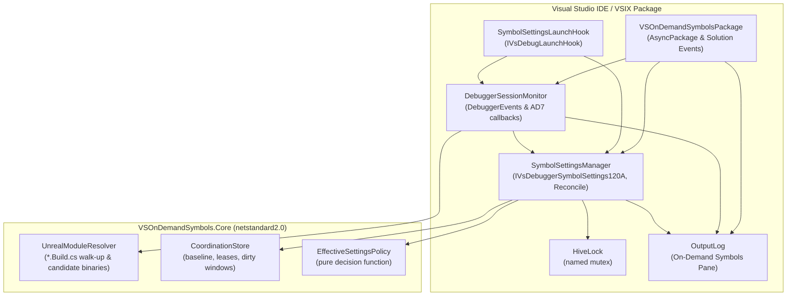
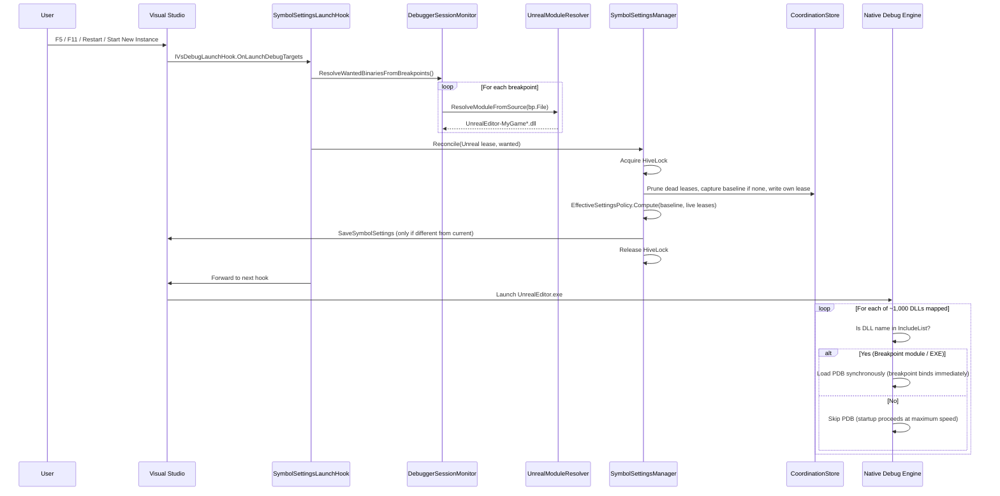
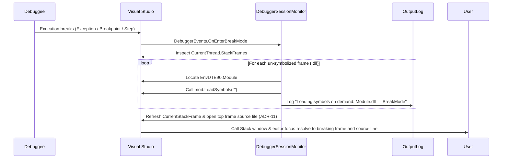
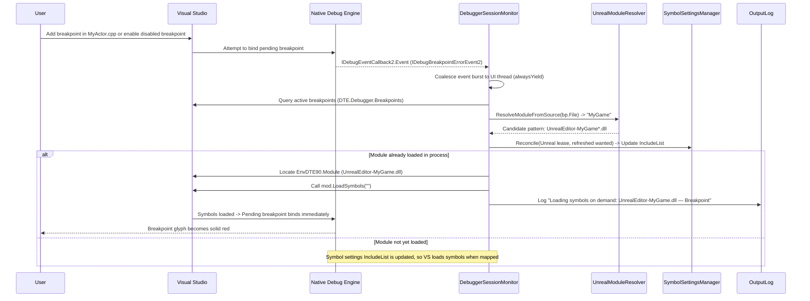
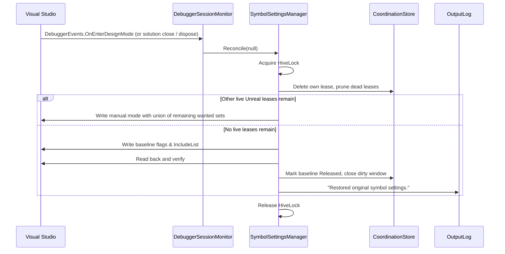

# Architecture — On-Demand Symbols

## 1. Solution Overview

**On-Demand Symbols** is a lightweight, zero-maintenance Visual Studio extension designed specifically to speed up debugging large native Unreal Engine 5 applications (ballpark ~1,000 DLLs).

The solution contains two projects and a small set of core source files:

```
VSOnDemandSymbols/
├── AGENTS.md                               # AI agent guide and build conventions
├── VSOnDemandSymbols.slnx                  # Solution file
├── docs/                                   # Architectural and design documentation
│   ├── ARCHITECTURE.md                     # This document (system architecture & design rationale)
│   ├── DECISIONS.md                        # Architecture Decision Records (ADR)
│   ├── IMPLEMENTATION_PLAN.md              # Active implementation plan (multi-instance coordination)
│   ├── MANUAL_VERIFICATION.md              # Manual test procedures in Experimental instance
│   ├── MODULE_RESOLUTION.md                # Unreal module naming and resolution reference
│   └── SPEC.md                             # Architectural and functional specification
│
├── src/
│   ├── VSOnDemandSymbols.Core/             # netstandard2.0 (Pure .NET, zero VS dependencies)
│   │   ├── Abstractions/                   # IFileSystem, ILogger, IClock, IProcessInfo
│   │   ├── Modules/
│   │   │   └── UnrealModuleResolver.cs     # *.Build.cs directory walk-up & candidate DLL generator
│   │   ├── Policy/
│   │   │   ├── BreakSymbolLoadMode.cs      # Break-mode symbol load policy (Off, LocalOnly, All)
│   │   │   └── WildcardPattern.cs          # Path sanitization & wildcard matching
│   │   └── State/
│   │       ├── SymbolSettingsSnapshot.cs   # Managed-field snapshot DTO
│   │       ├── CoordinationDtos.cs         # BaselineDto, SessionLeaseDto, DirtyWindowDto
│   │       ├── CoordinationStore.cs        # Baseline / leases / dirty windows, dead-lease pruning
│   │       └── EffectiveSettingsPolicy.cs  # Pure decision function over baseline + live leases
│   │
│   └── VSOnDemandSymbols/                  # net472 (Thin VS adapter, standard NuGet references)
│       ├── VSOnDemandSymbolsPackage.cs     # AsyncPackage, UI context auto-load, lifecycle
│       ├── Settings/
│       │   └── registration.json           # Modern Unified Settings manifest (Debugging -> Symbols)
│       ├── Debugger/
│       │   ├── IVsDebuggerSymbolSettings161.cs # COM interop for UseNugetSymbolServers
│       │   ├── IVsDebuggerSymbolSettings170.cs # COM interop for AutomaticSymbolLoad
│       │   ├── SymbolSettingsManager.cs    # Sole writer of IVsDebuggerSymbolSettings120A; Reconcile()
│       │   ├── SymbolSettingsLaunchHook.cs # IVsDebugLaunchHook: just-in-time reconcile on every launch
│       │   ├── HiveLock.cs                 # Named mutex per VS hive
│       │   └── DebuggerSessionMonitor.cs   # Breakpoints, bind errors, OnEnterBreakMode, OnEnterDesignMode
│       └── Logging/
│           └── OutputLog.cs                # "On-Demand Symbols" Output pane logger
│
└── tests/
    ├── Fixtures/MiniUnreal/                # Native C++ Unreal fixture (UnrealEditor.exe + 2 DLLs)
    ├── VSOnDemandSymbols.Core.Tests/       # xUnit / In-process unit test runner
    └── VSOnDemandSymbols.IntegrationTests/ # Out-of-proc DTE/ROT Experimental instance test runner
```

---

## 2. Component Diagram & Responsibilities



### Component Responsibilities

| Component | Project | Responsibility | Primary APIs Used |
|---|---|---|---|
| **`VSOnDemandSymbolsPackage`** | VSIX | Background package initialization, UI context auto-load on C++ solutions, solution open/close listener. Unreal detection arms the monitor only; it never writes settings. Calls `Reconcile(null)` on init (crash recovery), solution close, and dispose. | `AsyncPackage`, `IVsSolutionEvents` |
| **`SymbolSettingsLaunchHook`** | VSIX | Runs synchronously inside every `LaunchDebugTargets` in every instance. Unreal target: `Reconcile(Unreal lease)` with wanted binaries. Other targets: `Reconcile(Baseline lease)` only if settings may be leaked into this process; otherwise zero-touch. Always forwards to the next hook (ADR-15). | `IVsDebugLaunchHook` |
| **`SymbolSettingsManager`** | VSIX | Sole writer of symbol settings. `Reconcile(selfLease)` takes the hive lock, prunes dead leases, captures the baseline if needed, updates its own lease, writes the output of `EffectiveSettingsPolicy` only if it differs from current settings, and releases the baseline after a verified restore. Flags `ServerMaskActive` during break-mode masking (ADR-16). | `IVsDebuggerSymbolSettingsManager120A`, `IVsDebuggerSymbolSettings170` |
| **`HiveLock`** | VSIX | Cross-process critical section `Local\VSOnDemandSymbols.<VS_HIVE>` with 2 s timeout; abandoned mutex counts as acquired; timeout means "leave settings untouched". | `System.Threading.Mutex` |
| **`DebuggerSessionMonitor`** | VSIX | Resolves breakpoints (both enabled and disabled, ADR-03) to wanted binaries for the launch hook. Observes AD7 `IDebugBreakpointErrorEvent2` to refresh the lease and load symbols on demand when breakpoints are added while running. Subscribes to `OnEnterBreakMode` for call-stack loading and to `OnEnterDesignMode` to release the lease. | `EnvDTE80.DTE2`, `DebuggerEvents`, `IDebugEventCallback2`, `EnvDTE90.Module` |
| **`UnrealModuleResolver`** | Core | Resolves source files to module names by walking up the directory tree to find `{Module}.Build.cs` (handling intermediate UHT and unity paths). Generates candidate DLL names (`UnrealEditor-{Module}*.dll`). Detects Unreal solutions (`*.uproject` or `Engine/Build/Build.version`). | `IFileSystem`, `ConcurrentDictionary` cache |
| **`CoordinationStore`** | Core | Atomic JSON persistence for `baseline.json`, `leases/<pid>.json`, and `dirty-windows.json` under `%LOCALAPPDATA%/OnDemandSymbols/<VS_HIVE>/`. Prunes dead leases (PID + process start time). Migrates the legacy `symbol-settings-backup.json`. | `Newtonsoft.Json`, `IFileSystem`, `IProcessInfo`, `IClock` |
| **`EffectiveSettingsPolicy`** | Core | Pure function `(baseline, liveLeases) → effective settings + release decision`. Encodes priority rules P1 (Baseline lease wins) and P2 (Unreal wanted sets merge). | — |
| **`OutputLog`** | VSIX | Thread-safe logger outputting to the dedicated "On-Demand Symbols" pane in the Visual Studio Output window. | `IVsOutputWindowPane` |

---

## 3. Why Concord, MSBuild, and MRU Were Eliminated

During initial exploration (Phases 0–4), three complex subsystems were evaluated and subsequently removed. Their elimination is documented in [DECISIONS.md](DECISIONS.md).

### 3.1 Why Concord Was Eliminated
* **The Premise:** Concord (`Microsoft.VisualStudio.Debugger.Engine`) was initially considered to intercept DLL loads via `IDkmModuleInstanceLoadNotification` and call `moduleInstance.TryLoadSymbols()` synchronously off the UI thread without touching `IncludeList`.
* **The Reality:**
  1. **`TryLoadSymbols` is unsupported for native C++:** In Visual Studio, `DkmModuleInstance.TryLoadSymbols()` throws `NotImplementedException` (`0x80004001` / `E_NOTIMPL`) for native C++ modules. Visual Studio's native debug engine (`CppDebug.dll`) does not implement `IDkmSymbolLocator`.
  2. **Breakpoint glyph corruption:** Implementing Concord's `IDkmBreakpointManagerNotification` interfered with the AD7 event pipeline, causing breakpoint glyphs in the editor margin to remain hollow ("symbols not loaded") even when symbols had been successfully loaded.
  3. **Build & packaging overhead:** Concord required private IDE assembly references (`Microsoft.VisualStudio.Debugger.Engine.dll`), custom MSBuild targets (`Microsoft.VSSDK.Debugger.VSDConfigTool.targets`), `vsdconfigtool.exe`, `.vsdconfigxml` configuration files, and `DebuggerEngineExtension` VSIX assets.
* **The Solution:** Visual Studio's native debug engine automatically checks `IVsDebuggerSymbolSettings120A.IncludeList` during module mapping when manual mode is active. Mid-session loads are handled directly via standard DTE `Module.LoadSymbols("")`. Concord was completely stripped.

### 3.2 Why MSBuild Project Crawling Was Eliminated
* **The Premise:** An MSBuild project crawler (`MsBuildResolver`, `ProjectModelProvider`, `VCProjectEngine`) was initially built to support generic non-Unreal C++ solutions (`Scope = AllNative`).
* **The Reality:** Standard non-Unreal C++ solutions typically contain only a handful of DLLs and do not suffer from the ~1,000-DLL startup problem. Crawling MSBuild project dependency graphs introduced ~700 lines of complex COM interop, potential UI-thread deadlocks, and solution evaluation overhead.
* **The Solution:** Non-Unreal solutions are declared out of scope. When a non-Unreal solution is opened, the extension remains completely inert. For Unreal solutions, directory walk-up to `*.Build.cs` resolves modules in `< 1 ms`.

### 3.3 Why MRU, Pinning, and Persistent State Were Eliminated
* **The Premise:** An MRU (Most Recently Used) cache and module pinning list were proposed to persist previously symbolized modules across debugging runs into `.vs/state.json`.
* **The Reality:** On-demand symbol loading during break mode is fast (~100 ms). Carrying forward modules across sessions caused the `IncludeList` to bloat over time, steadily eroding the startup speedup that the extension exists to provide.
* **The Solution:** The `IncludeList` is populated before launch solely for modules with breakpoints, both enabled and disabled (plus `UnrealEditor.exe` and `UnrealEditor-Win64-*.exe`, ADR-03). No session history or per-solution state files are maintained.

---

## 4. Key Execution Sequences

### 4.1 Launch (any launch path) with Breakpoints



### 4.2 Break Mode On-Demand Symbol Loading



### 4.3 Breakpoint Added or Activated Mid-Session (Running or Break Mode)



### 4.4 Session End / Solution Close (Last Lease Restores)



### 4.5 Multi-Instance: Non-Unreal Instance Launches While Unreal Is Debugging

```mermaid
sequenceDiagram
    participant A as Instance A (Unreal)
    participant Store as CoordinationStore
    participant Reg as Shared VS hive settings
    participant B as Instance B (non-Unreal)

    A->>Store: Unreal lease + baseline captured
    A->>Reg: Manual mode + Unreal IncludeList
    Note over B: B starts and may load manual mode into memory
    B->>B: User presses F5 (launch hook)
    B->>Store: Baseline Active, so write Baseline lease
    B->>Reg: Restore baseline managed fields (P1: correctness beats speed)
    B->>B: Launch proceeds with user's settings
    Note over A: A keeps debugging; on-demand paths still load symbols
    B->>Store: Session end: delete Baseline lease
    B->>Reg: Only Unreal lease remains, so write manual mode again
    A->>Store: Session end: delete Unreal lease (last lease)
    A->>Reg: Restore baseline, verify, release baseline
```

---

## 5. Golden Rules & Thread Safety

1. **Golden Rule #1 (Settings Safety):** All modifications to Visual Studio symbol settings go strictly through `SymbolSettingsManager.Reconcile`, under the hive lock. The user's settings are captured once to a shared baseline before any modification, modified only during Unreal debug sessions, and restored by whichever instance releases the last lease (including dead-lease pruning after a crash). Symbol search paths, cache directory, exclude list, and symbol servers are never persistently modified.
2. **Multi-Instance Safety:** Symbol settings are shared by all instances of a VS hive. Instances coordinate through the baseline, leases, and dirty windows (SPEC §4.2), so any order of start, debug, crash, and exit leaves each debug session correct.
3. **Golden Rule #2 (Never Break Debugging):** Every debugger event handler and the launch hook are wrapped in `try / catch`. Any unexpected error logs a diagnostic message and allows Visual Studio to continue uninterrupted.
4. **Threading Guidelines:**
   - Always call `await JoinableTaskFactory.SwitchToMainThreadAsync()` before interacting with DTE, COM, or Visual Studio shell services.
   - Core library (`VSOnDemandSymbols.Core`) remains 100% free of Visual Studio dependencies and runs safely on any thread.
