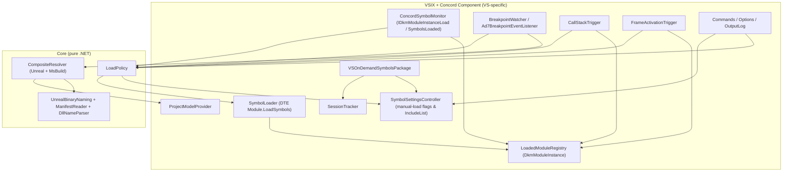
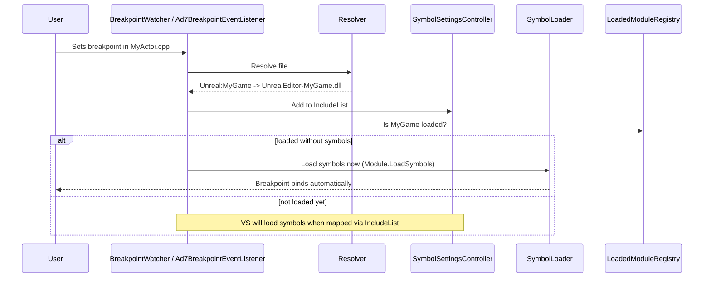

# Architecture

## 1. Solution layout (target)

```
VSOnDemandSymbols/
├─ AGENTS.md
├─ VSOnDemandSymbols.slnx
├─ docs/                                  # spec and design docs (this folder)
├─ src/
│  ├─ VSOnDemandSymbols/                  # VSIX package + Concord IDE component (net472).
│  │  ├─ VSOnDemandSymbolsPackage.cs
│  │  ├─ VSOnDemandSymbols.vsdconfigxml   # Concord component configuration → compiled to .vsdconfig
│  │  ├─ source.extension.vsixmanifest    # Registers Package + DebuggerEngineExtension asset
│  │  ├─ VSOnDemandSymbols.vsct           # commands, menus, toolbar
│  │  ├─ Commands/                        # Toggle, LoadNow, ShowToolWindow
│  │  ├─ Debugger/                        # Concord component + SymbolSettingsController + DTE hooks (§3)
│  │  ├─ Projects/                        # IProjectModelProvider implementation (DTE/VCProjectEngine)
│  │  ├─ Options/                         # DialogPage
│  │  ├─ ToolWindow/                      # WPF tool window + view model (Diagnostics / Status)
│  │  └─ Logging/                         # Output window pane logger
│  └─ VSOnDemandSymbols.Core/             # netstandard2.0. NO Visual Studio references.
│     ├─ Modules/                         # ModuleKey, resolvers, Unreal naming, manifests, DLL parser
│     ├─ Policy/                          # LoadPolicy, TriggerReason, WildcardPattern
│     └─ Abstractions/                    # IClock, IFileSystem, ILogger, IProjectModelProvider
└─ tests/
   ├─ VSOnDemandSymbols.Core.Tests/       # xUnit (net8.0 + net472), fixture trees, golden tests
   └─ Samples/NativeSample/               # small exe + dll + static lib solution for manual testing
```

The existing blank project currently sits at the repo root. Phase 1 moves it to `src/VSOnDemandSymbols/` and updates the `.slnx`.

**Rule:** anything that can be unit-tested without VS goes in Core. The VSIX project is a thin adapter.

## 2. Component diagram



## 3. Components

| Component | Responsibility | Thread |
|---|---|---|
| `VSOnDemandSymbolsPackage` | Async background load; builds the object graph; subscribes to solution events; crash-recovery restore at startup. | Background, then UI for service access |
| `SymbolSettingsController` | Back up, apply and restore VS symbol settings boolean flags (`IsManualLoad = true`, `IsLoadAdjacent = false`, `AutomaticSymbolLoad = false`) and manages `IncludeList` dynamically by merging active breakpoint modules with the user's backed-up original list (D-15, D-17, D-18, D-20). Single owner of symbol settings writes. Idempotent. | UI |
| `ConcordSymbolMonitor` | IDE-side Concord component (`ComponentLevel = 210000`, in-process in `devenv.exe`). Implements `IDkmModuleInstanceLoadNotification`, `IDkmModuleInstanceUnloadNotification`, `IDkmModuleSymbolsLoadedNotification`, and `IDkmProcessExitNotification`. Maintains `LoadedModuleRegistry`. | Concord engine worker thread (off UI thread) |
| `ConcordSymbolBridge` | Thread-safe in-process bridge holding current wanted-set snapshot and routing notifications. | Any (lock-free / concurrent) |
| `SessionTracker` | Session start/end, qualification (SPEC §7.3), session summary logging. No MRU bookkeeping. | UI / Engine |
| `LoadedModuleRegistry` | For each process: loaded modules → (`DkmModuleInstance`, path, `ModuleKey?`, symbol state). Reverse-maps each module to a key once, at load. | Any (`ConcurrentDictionary`) |
| `SymbolLoader` | De-duplicating queue of mid-session load requests (key + reason). Loads symbols via DTE `Module.LoadSymbols()`, tracks the result, and logs. | Background / UI |
| `BreakpointWatcher` / `Ad7BreakpointEventListener` | Observes breakpoint events (`IDebugBreakpointErrorEvent2`, design-time changes), resolves files to keys, updates `IncludeList`, and triggers on-demand loads. | UI for DTE, background for resolution |
| `CallStackTrigger` / `FrameActivationTrigger` | SPEC §5.2 and §5.3. Examines frames on break / frame activation and queues `SymbolLoader` for modules without symbols. | UI / background |
| `LoadPolicy` (Core) | Computes `IncludeList` set (SPEC §5.7) from breakpoint keys and `AlwaysLoadPatterns`; evaluates whether on-demand module loads are permitted against `NeverLoadPatterns`. | Any (immutable snapshots) |
| `CompositeResolver` (Core) | Source file → keys (MODULE_RESOLUTION.md). Cached. | Background |
| `ProjectModelProvider` (VSIX) | Exposes solution/project info (TargetPath, project membership, static-lib references) to Core through `IProjectModelProvider`. Snapshots are built on the UI thread and then used from any thread. | UI to build, any to read |
| `OutputLog` | `ILogger` implementation that writes to the "On-Demand Symbols" output pane; level filter. | Any (`OutputStringThreadSafe`) |

## 4. Key sequences

### 4.1 Launch (F5)

```mermaid
sequenceDiagram
    participant U as User
    participant VS as VS Shell
    participant H as BeforeLaunch hook / BreakpointWatcher
    participant P as LoadPolicy
    participant S as SymbolSettingsController
    participant D as VS Debug Engine
    U->>VS: F5
    VS->>H: Debug.Start BeforeExecute
    H->>P: Resolve active breakpoints
    P-->>H: Breakpoint modules (DLL names)
    H->>S: Update IncludeList (breakpoints + AlwaysLoad + user original)
    S-->>VS: SaveSymbolSettings(IncludeList)
    VS->>D: Launch UnrealEditor.exe (manual-load mode active)
    loop For each native DLL loaded at startup
        D->>D: Is DLL in IncludeList?
        alt In IncludeList
            D->>D: VS loads symbols natively; breakpoints bind immediately
        else Not in IncludeList
            D->>D: Symbols skipped; fast startup
        end
    end
```

### 4.2 Breakpoint set while running



## 5. Cross-cutting rules

- **Threading:** follow the VS threading rules. Use `JoinableTaskFactory`, `ThreadHelper.ThrowIfNotOnUIThread()` in every method that touches COM/DTE, and no `.Result` / `.Wait()`. Concord callbacks (`ConcordSymbolMonitor`) run on Concord worker threads and must never block on the VS UI thread. Do file I/O on background threads through `TaskScheduler.Default`.
- **Fault isolation:** wrap every event handler and Concord notification in try/catch → log. A failure in a trigger must never stop other triggers or the debug session (NF-5).
- **Testability:** time through `IClock`, the file system through an `IFileSystem` abstraction, logging through `ILogger`. No static state in Core.
- **Dependencies:** prefer what VS already ships (`Newtonsoft.Json`, `Microsoft.VisualStudio.Threading`, `Microsoft.VisualStudio.Debugger.Engine`). Don't bundle assemblies VS provides (`<Private>false</Private>`). Core references only netstandard2.0-compatible packages.
