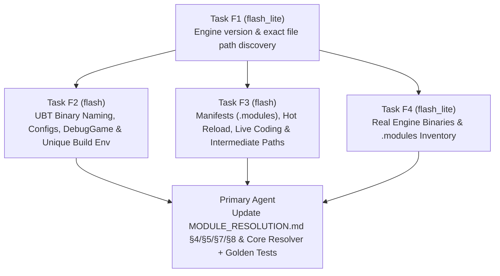

# Phase 2 Delegation Plan — Examining `D:\UnrealEngine` with Gemini Flash

## 1. Objective & Rationale

Phase 2 ([IMPLEMENTATION_PLAN.md](IMPLEMENTATION_PLAN.md), [AGENT_USAGE.md](AGENT_USAGE.md)) requires inspecting the Unreal Engine 5 source tree at `D:\UnrealEngine` (specifically UnrealBuildTool, `FModuleManager`, and Live Coding) to replace the provisional naming and resolution assumptions in [MODULE_RESOLUTION.md](MODULE_RESOLUTION.md) §§2–5 with confirmed rules backed by exact file and line citations.

Searching and reading large C# and C++ engine files (`UEBuildTarget.cs`, `UEBuildModuleCPP.cs`, `ModuleManager.cpp`, etc.) directly in the primary agent session would pull thousands of lines of raw engine source into the primary model's context window on every turn.

To optimize AI token and quota usage:
1. **Zero raw engine reads in the primary session:** The primary agent will **not** read or grep `D:\UnrealEngine` directly.
2. **Scoped subagent tasks on Gemini Flash (`flash_lite` and `flash`):** All file discovery, code extraction, and binary directory scans in `D:\UnrealEngine` are delegated to narrow, single-purpose `research` subagents via `invoke_subagent` with `Model: "flash_lite"` (for file discovery and directory listing) or `Model: "flash"` (for extracting exact C#/C++ methods and rules).
3. **Compact structured responses:** Each subagent prompt enforces a strict output template (file path, line range, verbatim snippet ≤ 40 lines per item, and a 1–2 sentence answer), returning only the distilled evidence needed to update [MODULE_RESOLUTION.md](MODULE_RESOLUTION.md) §8 and the Core unit tests.

---

## 2. Pre-Flight Check Before Running Phase 2

Before launching the Flash subagents when Phase 2 begins:
1. Confirm with the user that `D:\UnrealEngine` has finished downloading/extracting and permission is granted to read it.
2. Since `D:\UnrealEngine` is outside the workspace (`C:\Dev\VSOnDemandSymbols`), verify whether read-only tools (`read_file` / `find_by_name` / `grep_search`) in the `research` subagent can access `D:\UnrealEngine` directly, or if a single `self` subagent (`Model: "flash"`) should be used if elevated read access outside the workspace is required.

---

## 3. Subagent Task Breakdown

The Phase 2 checklist in [MODULE_RESOLUTION.md](MODULE_RESOLUTION.md) §4 is split into **4 parallelizable Flash subagent tasks** (`F1`–`F4`). `F1` runs first to locate exact paths; `F2`, `F3`, and `F4` can then run in parallel with exact file paths (avoiding redundant directory scans).

### Task F1 — Engine Version & Exact File Path Discovery
- **Subagent configuration:** `TypeName: "research"`, `Model: "flash_lite"`, `Role: "UE5 File Locator"`
- **Goal:** Read `D:\UnrealEngine\Engine\Build\Build.version` and find the exact paths of the ~12 UBT and runtime source files needed by Tasks F2 and F3.
- **Prompt template:**
  > Read `D:\UnrealEngine\Engine\Build\Build.version` and return its exact JSON contents.
  > Then locate the exact file paths under `D:\UnrealEngine\Engine\Source\Programs\UnrealBuildTool` and `D:\UnrealEngine\Engine\Source` for:
  > 1. `UEBuildTarget.cs`
  > 2. `UEBuildModule.cs` and `UEBuildModuleCPP.cs`
  > 3. `UEBuildBinary.cs`
  > 4. `TargetRules.cs` and `ModuleRules.cs`
  > 5. `ModuleManifest.cs`
  > 6. `HotReload.cs`
  > 7. `ModuleManager.cpp` (under `Runtime/Core`)
  > 8. LiveCoding source files handling patch naming/loading (under `Developer/Windows/LiveCoding` or `Programs/UnrealBuildTool`)
  >
  > Return ONLY the `Build.version` JSON and a bulleted list of the exact absolute file paths. Do not read the C# or C++ files.

### Task F2 — UBT Binary Naming, Configurations, DebugGame & Unique Build Environment
- **Subagent configuration:** `TypeName: "research"`, `Model: "flash"`, `Role: "UBT Naming Analyst"`
- **Inputs:** Exact paths to `UEBuildTarget.cs`, `UEBuildModule.cs`, `UEBuildModuleCPP.cs`, `UEBuildBinary.cs`, `TargetRules.cs`, `ModuleRules.cs` from Task F1.
- **Checklist items covered ([MODULE_RESOLUTION.md](MODULE_RESOLUTION.md) §4):**
  1. `MakeBinaryFileName` signature and implementation: how `{AppPrefix}-{ModuleName}[-{Platform}-{Configuration}].dll` is constructed.
  2. How `AppName` / `AppPrefix` is chosen for `UnrealEditor`, `UnrealGame`, and when `BuildEnvironment == TargetBuildEnvironment.Unique` (`bUseUniqueBuildEnvironment`). Where are binaries output in `Unique` mode?
  3. `UndecoratedConfiguration`: when is the `-{Platform}-{Configuration}` suffix omitted?
  4. `DebugGame` per-module suffix logic: how UBT decides whether a module gets the `-Win64-DebugGame` suffix vs the undecorated Development name (e.g. `bTreatAsEngineModule` or context check).
  5. Architecture suffixes (`UnrealArch`) on Win64 vs Arm64/Arm64EC.
  6. Monolithic vs modular detection (`TargetRules.LinkType`, `bShouldCompileAsDLL`).
  7. Any `ModuleRules` properties that alter the output binary name or subfolder (`BinariesSubFolder`, `ShortName`, `bUsePrecompiled`, `Engine/Platforms/*`, `Engine/Restricted/*`).
- **Output constraint:** For each of the 7 items, return the file path, line numbers, a concise explanation, and the exact relevant code snippet (≤ 35 lines per snippet).

### Task F3 — `.modules` Manifests, Hot Reload, Live Coding & Intermediate Layouts
- **Subagent configuration:** `TypeName: "research"`, `Model: "flash"`, `Role: "UBT Manifest & LiveCoding Analyst"`
- **Inputs:** Exact paths to `ModuleManifest.cs`, `ModuleManager.cpp`, `HotReload.cs`, `UEBuildModuleCPP.cs`, and LiveCoding files from Task F1.
- **Checklist items covered ([MODULE_RESOLUTION.md](MODULE_RESOLUTION.md) §2.1, §3, §4):**
  1. `ModuleManifest.cs` & `ModuleManager.cpp`: How the `.modules` file name is constructed per configuration/architecture (`GetFileName`), its JSON schema (`BuildId`, `Modules`), and how `FModuleManager` reads it at runtime.
  2. `HotReload.cs`: Exact hot-reload DLL suffix format (e.g. `-{NNNN}.dll`) and where hot-reload regex/replacement happens.
  3. Live Coding (`LiveCoding`): How Live++ / Live Coding names patch binaries and PDBs (e.g. `.patch_0.exe` / `.pdb`), where they reside on disk, and whether they load via normal module load events.
  4. Intermediate directory layouts for generated files (`Inc/<Module>/UHT/*.gen.cpp`) and unity build files (`Module.<Name>.cpp` or `Module.<Name>.1_of_N.cpp`).
- **Output constraint:** For each of the 4 items, return the file path, line numbers, a concise explanation, and the exact relevant code snippet (≤ 35 lines per snippet).

### Task F4 — Real Engine Binaries & `.modules` Inventory (Optional / If Built)
- **Subagent configuration:** `TypeName: "research"`, `Model: "flash_lite"`, `Role: "UE5 Binary Inventory Scanner"`
- **Goal:** Check whether `D:\UnrealEngine\Engine\Binaries\Win64` has built binaries and `.modules` manifests.
- **Prompt template:**
  > Check if `D:\UnrealEngine\Engine\Binaries\Win64` exists.
  > 1. If it exists, list all `*.modules` files in `D:\UnrealEngine\Engine\Binaries\Win64` and read the first 40 lines of `UnrealEditor.modules` (if present).
  > 2. Count how many `UnrealEditor-*.dll` files exist under `D:\UnrealEngine\Engine\Binaries\Win64` and `D:\UnrealEngine\Engine\Plugins\**\Binaries\Win64`.
  > 3. Report any `UnrealEditor-*.dll` file names that contain more than one hyphen `-` after `UnrealEditor-` (to test edge cases in our reverse-mapping parser).
  > Return a brief summary under 60 lines.

---

## 4. Synthesis & Verification Workflow (Primary Agent)

Once Tasks F1–F4 return their structured summaries:
1. Update [MODULE_RESOLUTION.md](MODULE_RESOLUTION.md) §8 ("Confirmed UBT findings") with the exact engine version and code citations from F1–F3.
2. Update [MODULE_RESOLUTION.md](MODULE_RESOLUTION.md) §§2–5 and §7 from "provisional" to "confirmed".
3. Update `UnrealModuleNaming`, `UnrealModuleResolver`, and `ModuleManifestReader` in `VSOnDemandSymbols.Core` to match any nuances discovered.
4. Add unit tests in `tests/VSOnDemandSymbols.Core.Tests` covering all confirmed edge cases, plus the opt-in `Category=Unreal` integration test (`ODS_UE_ROOT=D:\UnrealEngine`).
5. Tick the Phase 2 checkboxes in [IMPLEMENTATION_PLAN.md](IMPLEMENTATION_PLAN.md) and commit.
