# VS On-Demand Symbols — Architecture & Functional Specification

| | |
|---|---|
| **Product** | Visual Studio Extension (VSIX) "On-Demand Symbols" |
| **Status** | Approved Architecture Specification |
| **Targets** | Visual Studio 2022 17.14+ and Visual Studio 2026 (x64), native C++ debugging |
| **Primary Use Case** | Debugging Unreal Engine 5.x editor builds (`UnrealEditor.exe` with ballpark ~1,000 `UnrealEditor-*.dll` modules, e.g. ~930–1,130 in Lyra) |

---

## 1. Problem & Goal

### 1.1 The Problem
The Unreal Editor loads ballpark ~1,000 DLLs at startup (e.g. 933 Unreal modules and 950+ total DLLs mapped during Lyra editor startup). Loading debug symbols (PDBs) for all of them doubles editor boot time under the debugger. Usually only a handful of modules need symbols:
- Modules containing breakpoints (both enabled and disabled, so enabling a breakpoint mid-session binds immediately)
- Modules on the call stack when execution breaks (needed to diagnose exceptions and inspect code)

Visual Studio provides a "Load only specified modules" mode, but managing that include list by hand across ~1,000 DLLs is impractical.

### 1.2 The Goal
Provide an **invisible, transparent, zero-maintenance** extension that:
1. **Accelerates boot time:** Puts VS into manual-load mode and loads symbols at startup *only* for modules with breakpoints (plus `UnrealEditor.exe`). Startup speed is within 10% of booting with symbol loading completely disabled.
2. **Guarantees breakpoint binding:** Breakpoints bind immediately at launch without user intervention.
3. **Resolves call stacks on break:** When execution stops (breakpoint hit, crash, assertion, step), missing symbols for the breaking thread's stack frames are loaded on demand via DTE.
4. **Never damages user settings:** The user's original symbol settings flags and original `IncludeList` are backed up to disk and restored on solution close, extension disable, VS exit, or after a crash (**Golden Rule #1**).

### 1.3 Scope & Non-Goals
- **In Scope:** Unreal Engine 5.x solutions (`.sln` / `.slnx`) debugging native C++.
- **Out of Scope (Explicit Non-Goals):**
  - Non-Unreal MSBuild solutions (standard C++ solutions have only a few DLLs and do not suffer from the ~1,000-DLL startup problem).
  - Monolithic builds (single executable; no modular DLLs).
  - Managed (.NET) code, Linux/Android/consoles, and remote debugging.
  - Complex diagnostic tool windows (the extension is invisible; status is reported to the Output window).

---

## 2. Hard-Won Insights & Architecture Decisions

This architecture incorporates critical empirical lessons learned across development and testing:

1. **Native VS IncludeList handles startup loading (ADR-01):**
   When `IsManualLoad = true` and `IsLoadAdjacent = false`, Visual Studio's native debug engine (`CppDebug.dll`) automatically inspects `IVsDebuggerSymbolSettings120A.IncludeList` during module mapping. If a module's file name matches an entry, VS natively loads its PDB synchronously before `StartupModule()` executes.
2. **Concord is completely eliminated (ADR-01, ADR-02):**
   `DkmModuleInstance.TryLoadSymbols()` throws `NotImplementedException` (`0x80004001` / `E_NOTIMPL`) in Visual Studio for native C++ modules. Furthermore, Concord's `IDkmBreakpointManagerNotification` breaks editor breakpoint glyphs. Concord provides no functional symbol-loading capability for native C++. Stripping Concord entirely eliminates `.vsdconfig`, `vsdconfigtool.exe`, and unmanaged IDE DLL references.
3. **Mid-session on-demand loading uses standard DTE (ADR-02):**
   When execution stops in break mode, invoking `EnvDTE90.Module.LoadSymbols("")` on the breaking thread's un-symbolized modules immediately commands VS to load their PDBs.
4. **No MRU, pinning, or state tracking across runs (ADR-08):**
   On-demand loading during breaks is fast (~100 ms). Carrying forward module history across sessions via MRU lists or `.vs/state.json` is unnecessary and degrades startup time.
5. **No MSBuild project crawler (ADR-09):**
   Unreal Engine uses UnrealBuildTool (UBT) and `*.Build.cs` files rather than MSBuild project graphs. Standard MSBuild project dependency crawling is completely bypassed in favor of a fast `*.Build.cs` directory walk-up.

---

## 3. High-Level Flow

```mermaid
flowchart TD
    subgraph S1["1. Solution Opened (Unreal Detected)"]
        SO["Unreal Solution Opened"] --> BK["Backup user symbol settings & IncludeList to disk"]
        BK --> SET["Apply IsManualLoad=true, IsLoadAdjacent=false, AutomaticSymbolLoad=false"]
    end

    subgraph S2["2. Launch (F5) / Breakpoint Change"]
        F5["F5 / Launch Command"] --> BPS["Query DTE.Debugger.Breakpoints"]
        BPS --> RES["UnrealModuleResolver: walk up to *.Build.cs"]
        RES --> INC["Write UnrealEditor-{Module}*.dll + UnrealEditor*.exe to IncludeList"]
        INC --> RUN["Launch UnrealEditor.exe"]
        RUN --> VSN["VS native engine loads symbols ONLY for IncludeList DLLs"]
    end

    subgraph S3["3. Break Mode / Call Stack"]
        BRK["Execution breaks (Exception / Breakpoint / Step)"] --> DTE_BRK["DebuggerEvents.OnEnterBreakMode"]
        DTE_BRK --> FRAMES["Inspect CurrentThread.StackFrames"]
        FRAMES --> LOAD["Invoke Module.LoadSymbols('') for un-symbolized frames"]
        LOAD --> SHOW["Call Stack window resolves instantly"]
    end

    subgraph S4["4. Solution Closed / VS Exit"]
        SC["Solution Closed / VS Exit / Crash"] --> RST["Restore user original symbol settings & IncludeList from disk backup"]
    end
```



---

## 4. Component Architecture

The codebase consists of two projects and only **6 core source files**:

```
VSOnDemandSymbols/
├── src/
│   ├── VSOnDemandSymbols.Core/             # netstandard2.0 (Pure .NET, zero VS dependencies)
│   │   ├── Abstractions/                   # IFileSystem, ILogger, IClock
│   │   ├── Modules/
│   │   │   └── UnrealModuleResolver.cs     # *.Build.cs walk-up, candidate DLL generator, Unreal solution check
│   │   ├── Policy/
│   │   │   ├── BreakSymbolLoadMode.cs      # Off, LocalOnly (default), All
│   │   │   └── WildcardPattern.cs          # Wildcard pattern matcher (*, ?)
│   │   └── State/
│   │       └── SymbolSettingsBackupStore.cs# JSON backup read/write & PID crash recovery
│   │
│   └── VSOnDemandSymbols/                  # net472 (Thin VS adapter, pure NuGet references)
│       ├── VSOnDemandSymbolsPackage.cs     # AsyncPackage, UI context rule, lifecycle
│       ├── Debugger/
│       │   ├── SymbolSettingsManager.cs    # Reads/writes IVsDebuggerSymbolSettings120A & backup
│       │   └── DebuggerSessionMonitor.cs   # BeforeExecute (F5) hook, Breakpoints, OnEnterBreakMode
│       └── Logging/
│           └── OutputLog.cs                # "On-Demand Symbols" Output pane logger
│
└── tests/
    └── VSOnDemandSymbols.Core.Tests/       # xUnit / In-process test runner with InMemoryFileSystem
```

### 4.1 Component Details

#### 1. `UnrealModuleResolver` (Core)
* Given a source file path (e.g. `D:\MyProject\Source\MyGame\Private\MyActor.cpp`):
  * Special case: Intermediate UHT files (`Intermediate/Build/.../Inc/{Module}/...`) or unity files (`Module.{Module}.*.cpp`) extract the module name directly from the path.
  * Standard case: Walks up parent directories looking for `{Module}.Build.cs`. Stops at root boundaries (`*.uproject`, `*.uplugin`, `Engine/Source`, drive root). Caches all visited directory $\to$ module mappings (including negative results) in a `ConcurrentDictionary`, cleared on solution close via `ClearCache()`.
* Given a module name (`MyGame`):
  * Returns the wildcard binary pattern `UnrealEditor-MyGame*.dll` (ADR-07), which matches all configurations (`Development`, `DebugGame`, `Debug`, `Shipping`) and hot-reload suffixes (`-0001`).
* Solution detection:
  * `IsUnrealSolution(dir)`: checks for `*.uproject` or `Engine/Build/Build.version` (walking up for nested project files).

#### 2. `SymbolSettingsBackupStore` (Core)
* Manages `%LOCALAPPDATA%/OnDemandSymbols/<VS_INSTANCE>/symbol-settings-backup.json`.
* Stores: `IsManualLoad`, `IsLoadAdjacent`, `AutomaticSymbolLoad`, `UseMSSymbolServers`, `UseNugetSymbolServers`, `SymbolPaths`, `IncludeList` (names + enabled flags), timestamp, and `ProcessId`.
* `CheckCrashRecovery(path, currentPid)`: If backup exists and the recorded PID is dead, returns the backup so settings (including any temporarily masked symbol server flags/paths) can be restored before doing anything else.

#### 3. `SymbolSettingsManager` (VSIX)
* Single owner of Visual Studio symbol settings (`SVsShellDebugger` $\to$ `IVsDebuggerSymbolSettingsManager120A`).
* `ApplyManualMode(wantedBinaries)`:
  * Ensures disk backup is saved.
  * Sets `IsManualLoad = true`, `IsLoadAdjacent = false`, `AutomaticSymbolLoad = false`.
  * Merges the user's backed-up original `IncludeList` with the active `wantedBinaries` (skipping redundant saves if the effective `IncludeList` is unchanged).
  * Saves settings with `loadSymbolsNow: false`.
* `RestoreOriginalSettings()`:
  * Restores user's original manual-load flags and `IncludeList` (preserving any user edits made to symbol paths or servers during the session).
  * Deletes disk backup.

#### 4. `DebuggerSessionMonitor` (VSIX)
* Subscribes to `DTE.Events.CommandEvents` for `StandardCommandSet97:cmdidStart (295)` (F5 Launch).
  * Resolves all breakpoints (both enabled and disabled, ADR-03) from `DTE.Debugger.Breakpoints`.
  * Adds `UnrealEditor*.exe` and candidate DLL patterns (`UnrealEditor-{Module}*.dll`) to `IncludeList` via `SymbolSettingsManager`.
* Subscribes to AD7 `IVsDebugger.AdviseDebugEventCallback` (`IDebugBreakpointErrorEvent2`):
  * When a new breakpoint is added mid-session while running (or in break mode), Visual Studio's debug engine reports a binding error if the module's symbols are not loaded.
  * Coalesces error event bursts to the UI thread, rescans breakpoints via DTE, updates `IncludeList`, and invokes `mod.LoadSymbols("")` on matching un-symbolized modules in `DTE.Debugger.DebuggedProcesses`.
  * Breakpoints activate immediately without restarting the debug session.
  * Logs symbol loads with reason `Breakpoint`.
* Subscribes to `DTE.Events.DebuggerEvents.OnEnterBreakMode` and `OnContextChanged`:
  * Governed by `BreakSymbolLoadMode` (`Off`, `LocalOnly` [default], `All`), configurable via Visual Studio Unified Settings (`Debugging -> Symbols -> On Demand Loading`).
  * Inspects `CurrentThread.StackFrames` fully, and for non-step breaks (breakpoint hits, exceptions, manual break) up to 10 frames of background threads in `CurrentProgram.Threads` (stopping at the first user-code module). Single-stepping (F10/F11) inspects only `CurrentThread`.
  * For `LocalOnly`, temporarily masks remote symbol servers so Visual Studio native loader resolves only adjacent, locally cached, or local path PDBs without network latency.
  * For `All`, resolves symbols with remote symbol servers unmasked.
  * For each frame without symbols, locates matching `EnvDTE90.Module` and calls `mod.LoadSymbols("")`.
  * Logs symbol loads with reason `BreakMode` or `ContextChanged`.

#### 5. `VSOnDemandSymbolsPackage` (VSIX)
* Attributes: `[ProvideAutoLoad(CppSolutionUiContextGuidString, PackageAutoLoadFlags.BackgroundLoad)]`.
* UI context rule: triggers on C++ solutions.
* Detects Unreal solutions (contains `*.uproject` or `Engine/Build/Build.version`).
* Handles crash recovery on startup.
* Operates transparently in the background with zero custom UI commands; diagnostics and status are logged to the "On-Demand Symbols" Output pane.

---

## 5. Non-Functional Requirements & Rules

1. **Golden Rule #1 (Settings Safety):** User symbol settings are *always* backed up to disk before any modification and restored on solution close, disable, or crash recovery. Symbol search paths, cache directory, and symbol servers are never persistently modified (remote symbol servers are only masked within a scoped `try / finally` block during `LocalOnly` break-mode loading, and backed up to disk to guard against mid-break crashes).
2. **Never Break Debugging (Golden Rule #2):** All debugger event handlers are wrapped in `try / catch`. Failures log a warning and let Visual Studio proceed normally.
3. **No Private IDE Assemblies:** Zero references to internal Visual Studio DLLs outside of official NuGet packages (`Microsoft.VisualStudio.SDK 17.14.40265`). Zero custom compiler targets (`.vsdconfig`).
4. **Sandboxed Build Safe:** Respect `/p:UseSharedCompilation=false /nr:false` and run unit tests via in-process runner.
