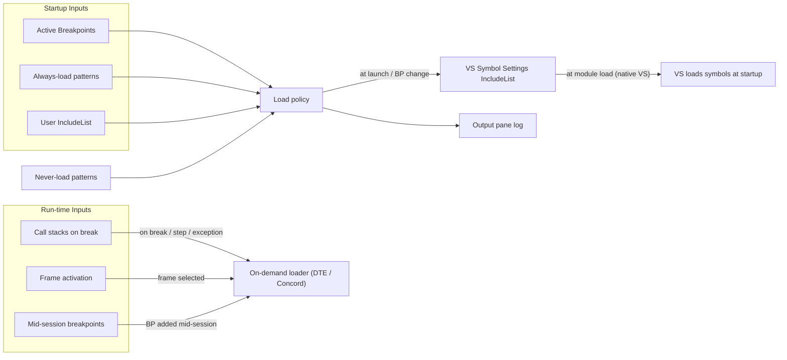

# VS On-Demand Symbols — Functional Specification

| | |
|---|---|
| **Product** | Visual Studio extension (VSIX) "On-Demand Symbols" |
| **Status** | Draft v1.0, written before implementation |
| **Targets** | Visual Studio 2022 17.14+ and Visual Studio 2026 (x64), native C++ debugging |
| **Primary use case** | Debugging Unreal Engine 5.x editor builds (`UnrealEditor.exe` with about 800 `UnrealEditor-*.dll` modules) |
| **Related docs** | [ARCHITECTURE.md](ARCHITECTURE.md), [MODULE_RESOLUTION.md](MODULE_RESOLUTION.md), [VS_DEBUGGER_INTEGRATION.md](VS_DEBUGGER_INTEGRATION.md), [IMPLEMENTATION_PLAN.md](IMPLEMENTATION_PLAN.md), [TESTING.md](TESTING.md), [DECISIONS.md](DECISIONS.md) |

---

## 1. Problem statement

The Unreal Editor loads about 800 DLLs at startup. Loading debug symbols (PDBs) for all of them can roughly double the editor's boot time under the debugger. Usually only a handful of modules need symbols: the game modules being worked on, the module where a breakpoint is set, and the modules on the call stack when execution stops.

Visual Studio can already "load only specified modules", but the user has to keep that include list up to date by hand. In practice, nobody does.

## 2. Goal

Automatically keep symbol loading limited to the modules that are likely to be needed. Then load symbols for any other module **immediately and transparently** when it becomes needed. The user should never have to open the Modules window to fix a breakpoint that won't bind.

### 2.1 Success criteria

1. **Startup time:** editor startup under the debugger with the extension enabled is within 10% of startup with symbol loading fully disabled, plus the cost of the modules that actually needed symbols.
2. **Breakpoints:** a breakpoint set in any C++ file binds and is hit, whether it was set before launch or while the process is running. No manual symbol loading is needed.
3. **Call stacks:** when execution breaks, the call stack shows function names and source lines for every frame without manual action (subject to the configured call-stack mode).
4. **No damage:** the user's own Visual Studio symbol settings are always restored. This includes after a VS crash.
5. **Explainability:** every symbol load the extension causes is logged with its reason.

### 2.2 Non-goals (v1)

- Managed (.NET) and mixed-mode symbol management. The extension only acts on native modules.
- Monolithic Unreal targets (packaged games, Shipping/Test builds where all code is in one EXE). The extension detects these and does nothing beyond the always-load list.
- CMake / Open Folder projects, and Unreal projects opened through `.uproject` workspace mode (no `.sln` or `.slnx`). These are possible future work.
- Remote debugging, and debugging non-Windows platforms (consoles, Android, Linux).
- Managing symbol *servers* or symbol *paths*. The extension never modifies these.

---

## 3. Glossary

| Term | Meaning |
|---|---|
| **Module** | A DLL or EXE loaded into the debuggee. |
| **UBT module** | An Unreal Build Tool module, defined by `<Name>.Build.cs`. In modular editor builds, one UBT module = one DLL. |
| **Module key** | The extension's stable identity for a module (see §6.1). For Unreal this is the UBT module name, for example `MyGame` or `Engine`. For non-Unreal projects it is the output file name, for example `MyLib.dll`. |
| **Session / run** | One debug session (launch or attach) of a qualifying process, from start until the debugger returns to design mode. |
| **Trigger** | An event that means a module's symbols are needed (§5). |
| **Wanted set** | The set of module keys / binary file names containing active breakpoints (plus always-load patterns) that are populated into the debugger's `IncludeList` for launch. |
| **Qualifying session** | A debug session the extension acts on, according to the Scope setting (§7.1). |

---

## 4. How it works (overview)

1. While a qualifying solution is open (and the extension is enabled), the extension puts the Visual Studio symbol settings into **"Load only specified modules"** ("Automatically choose what module symbols to search for") mode (`IsManualLoad = true`). It turns off **"Always load symbols located next to modules"** (`IsLoadAdjacent = false`, because Unreal PDBs live next to their DLLs) and **"Automatically include additional symbols when needed"** (`AutomaticSymbolLoad = false`, so call-stack symbol loading obeys the extension's `CallStackMode` and never-load rules; see D-13). The user's original `IncludeList` is backed up and preserved (D-17).
2. The extension resolves all active breakpoints to module binary names. These breakpoint modules (plus any `AlwaysLoadPatterns` and preserving the user's original `IncludeList` entries) are written to Visual Studio's **`IncludeList`** (`IVsDebuggerSymbolSettings120A.IncludeList`) before launch and whenever breakpoints change.
3. At launch, Visual Studio natively inspects `IncludeList` and loads symbols automatically for modules with breakpoints as they map into the process, allowing breakpoints to bind immediately.
4. While the session runs, when execution breaks (breakpoint hit, exception, assertion, step, or pause) or the user inspects stack frames, symbols for un-symbolized frames are loaded **on demand** (via DTE `Module.LoadSymbols()`). Loading on demand when execution stops is fast enough that carrying forward previously loaded modules across sessions via an MRU or pinned list is unnecessary (D-20).
5. When the solution closes, the extension is disabled, or VS shuts down, the user's original symbol settings flags and `IncludeList` are restored.



---

## 5. Triggers: when symbols are loaded

Each trigger has a **reason code**. The reason is logged in the Output pane. A trigger loads the module's symbols (via the `IncludeList` at startup or via on-demand load during break mode), unless the key matches a never-load pattern.

### 5.1 Breakpoints — reason `Breakpoint`

| ID | Requirement |
|---|---|
| BP-1 | At session start (and whenever breakpoints change before launch), every **enabled** file/line breakpoint (including tracepoints) in `DTE.Debugger.Breakpoints` is resolved to module key(s) and binary file name(s), which are written to Visual Studio's `IncludeList`. |
| BP-2 | A breakpoint added or enabled **while the process is running or in break mode** updates the `IncludeList` and triggers an immediate on-demand load (`Module.LoadSymbols()`) if the module is already loaded without symbols, so the breakpoint binds immediately. |
| BP-3 | Disabled breakpoints are ignored by default (setting `IncludeDisabledBreakpoints`). |
| BP-4 | Function breakpoints that are module-qualified (`UnrealEditor-MyGame.dll!AMyActor::Tick` or `{,,UnrealEditor-MyGame.dll}AMyActor::Tick`) trigger for that module. Unqualified function breakpoints can't be resolved in v1; they are logged at Verbose level. |
| BP-5 | Breakpoints in header files resolve to the module that owns the header's folder (§6). Inlined copies in other modules are not covered; this is a documented limitation. |
| BP-6 | Breakpoints whose file can't be resolved to a module produce one warning in the log per file per session. |
| BP-7 | Data breakpoints and address breakpoints are ignored. |

### 5.2 Call stack on break — reason `CallStack`

| ID | Requirement |
|---|---|
| CS-1 | When the debugger enters break mode (breakpoint hit, step complete, user pause, exception, `__debugbreak`/`check`/`ensure`), the frames selected by `CallStackMode` are examined. Every frame whose module has no symbols triggers an immediate on-demand load. |
| CS-2 | `CallStackMode` values: `None`; `CurrentThread`; `CurrentThreadAllThreadsOnException` (**default**); `AllThreads`. With the default, all threads are examined only when the stop reason is an exception, an unhandled exception/crash, or a hard-coded break (`__debugbreak`, which is how UE's `check`/`ensure` failures stop). |
| CS-3 | `CallStackMaxFrames` (default 128) limits how many frames per thread are examined. |
| CS-4 | Frames in modules outside the solution (Windows, CRT, drivers, third-party) also load symbols by default. This can use the user's configured symbol servers. Setting: `CallStackIncludeExternalModules` (default `true`). The never-load list can exclude specific ones. |
| CS-5 | After symbols load, the Call Stack window must show the resolved frames without the user having to step. If VS doesn't refresh on its own, the extension forces a refresh (see [VS_DEBUGGER_INTEGRATION.md](VS_DEBUGGER_INTEGRATION.md) §5). |
| CS-6 | Call-stack loads happen asynchronously, so break mode is entered without waiting. The UI may show unresolved frames briefly. |

### 5.3 Frame activation — reason `FrameActivated`

| ID | Requirement |
|---|---|
| FA-1 | When the user activates a stack frame (double-clicks it in the Call Stack, Threads or Parallel Stacks window, or switches the current thread) and that frame's module has no symbols, the extension loads them on demand. Setting: `LoadOnFrameActivation` (default `true`). |
| FA-2 | When FA-1 fires for a thread whose stack hasn't been examined, the whole stack of that thread is examined, as in CS-1 with `CurrentThread` semantics. |

### 5.4 Recently built — *(removed per [DECISIONS.md](DECISIONS.md) D-16)*

Binary modification timestamps (`RB-1`–`RB-5`) are not used as a trigger. Symbols are loaded at startup only for modules with breakpoints and `AlwaysLoadPatterns`. Hot-reload (`UnrealEditor-X-1234.dll`) and Live Coding patch modules (`*.patch_N.exe`) map to their parent `ModuleKey` via the DLL name parser (§6.2), so if the module has a breakpoint, its patch symbols load automatically.

### 5.5 Manual loads — reason `Manual`

| ID | Requirement |
|---|---|
| ML-1 | If symbols for a module are loaded by something other than the extension (for example the user clicks "Load Symbols" in the Modules window or on the "No symbols loaded" page), the extension logs the event with reason `Manual`. |
| ML-2 | The "Load Symbols for This Module Now" command (§8.4) also triggers an on-demand load and logs `Manual`. |

### 5.6 MRU list and pinning — *(removed per [DECISIONS.md](DECISIONS.md) D-20)*

The MRU feature and pruning rules (MRU-1 through MRU-8), as well as module pinning, are removed. On-demand symbol loading when execution stops is fast enough that carrying forward previously loaded modules across sessions is unnecessary. Startup symbol loading is restricted solely to modules that currently have breakpoints (plus `AlwaysLoadPatterns`), maximizing startup performance and eliminating state tracking across runs.

### 5.7 Load policy (how IncludeList and on-demand loads are computed)

```
IncludeList (before launch / on breakpoint change) = 
       User Original IncludeList
     ∪ AlwaysLoad patterns
     ∪ Breakpoint module keys/binaries
     − NeverLoad patterns
```

- **Startup:** Only the modules in `IncludeList` have symbols loaded when the process starts. Visual Studio checks `IncludeList` natively at module load time.
- **Mid-session on-demand loading:** When execution enters break mode (CS-1), a frame is selected (FA-1), or a breakpoint is added mid-session (BP-2), symbols for the relevant modules are loaded immediately via DTE `Module.LoadSymbols()`.
- **Never-load rules:** `NeverLoadPatterns` always wins over automatic triggers. It does **not** block explicit user actions (Modules window, "Load Symbols Now" command).

---

## 6. Resolving source files to modules

Full detail is in [MODULE_RESOLUTION.md](MODULE_RESOLUTION.md). Summary:

### 6.1 Module keys

- **Unreal:** the UBT module name, which is unique within a target (for example `Engine`, `MyGame`, `MyPluginEditor`). One key may match several DLL file names (configuration suffixes, hot-reload copies, Live Coding patches).
- **MSBuild / vcxproj:** the output file name of the project's active configuration, for example `MyLib.dll`.
- Keys are case-insensitive.

### 6.2 Unreal resolution

1. Special-case generated files under `Intermediate/Build/<Platform>/<Target>/Inc/<Module>/...` (UHT `.gen.cpp` files, unity files): the module name comes from the path.
2. Otherwise, walk up from the file's folder until a folder containing `*.Build.cs` is found. The module name is the file name without `.Build.cs`. Stop at the root of the drive, or at a folder containing `*.uproject`, `*.uplugin`, or the Engine root.
3. Map the module name to DLL file name(s), using UBT's `.modules` manifests next to the binaries when they exist. Otherwise use UBT's naming rules (derived from the UBT source; **pending analysis**, see MODULE_RESOLUTION.md §4).
4. At runtime, map loaded DLL names back to module names by parsing the file name (MODULE_RESOLUTION.md §5). This is how loaded modules are matched against keys.

### 6.3 Non-Unreal (vcxproj) resolution

1. Find the project(s) in the solution that contain the file.
2. Read the active configuration's `TargetPath`.
3. If the project builds a static library, follow reverse project references to the DLL/EXE projects that link it. Every such output becomes a key.
4. Files that aren't in any project: try the nearest project folder above the file. Otherwise the file is unresolved (BP-6).

---

## 7. Scope and lifecycle

### 7.1 Scope setting

`Scope` (default `UnrealOnly`):

| Value | Behaviour |
|---|---|
| `Off` | The extension never changes symbol settings. Same effect as the toolbar toggle being off. |
| `UnrealOnly` | Acts only when the open solution is an Unreal solution (§7.2). |
| `AllNative` | Acts for any solution that contains C++ projects. Unreal logic switches on automatically for Unreal solutions. |

The **Enabled** toggle (§8.1) is a separate master switch, so the user can pause the extension without losing the Scope choice.

### 7.2 Unreal solution detection

A solution counts as Unreal if any of the following is true:
- The solution folder, or the folder of any project in it, contains a `*.uproject`.
- It contains a project whose file lives under `**/Intermediate/ProjectFiles/` and an ancestor folder contains `Engine/Build/Build.version`.
- The user has forced it with the per-solution override (`ForceUnrealMode` in the per-solution state).

The engine root is the folder containing `Engine/Build/Build.version` found this way. The project root is the folder containing the `.uproject`. A solution can be engine-only (no project, for example `UE5.sln`).

### 7.3 Session qualification

A debug session qualifies when the extension is enabled, the Scope allows the solution, and the session debugs native code. In `UnrealOnly` mode, a process whose image name doesn't match `UnrealProcessPatterns` (default `UnrealEditor*.exe;UE4Editor*.exe;<ProjectName>*.exe`) is still debugged with the manual-load setting (because VS symbol settings are global), so for non-matching processes the Concord component can either leave them in manual mode or load their symbols if desired; triggers are skipped for non-qualifying processes.

### 7.4 Lifecycle of the VS symbol settings

| Event | Action |
|---|---|
| Qualifying solution opened, extension enabled | Back up the user's symbol settings flags and original `IncludeList` to disk (§9.2). Apply manual-load mode: `IsManualLoad = true`, `IsLoadAdjacent = false`, `AutomaticSymbolLoad = false` (D-13, D-17). |
| Before launch/attach (or when breakpoints change) | Resolve active breakpoints to module keys and binary names. Populate the user's original `IncludeList` + breakpoint modules + `AlwaysLoadPatterns` into VS's `IncludeList` (D-17, D-20). |
| Module loads during a session (`IDkmModuleInstanceLoadNotification`) | Visual Studio checks `IncludeList` natively and loads symbols synchronously at DLL map time for modules with breakpoints before `DllMain` / `StartupModule()`. |
| Trigger during a session (break / call stack / frame activation / mid-session breakpoint) | Load symbols on demand (`Module.LoadSymbols()`) immediately for the required module(s). |
| Session ends | Log session summary. (No MRU bookkeeping; no state saving). |
| Solution closed / extension disabled / Scope changed to exclude / VS shutdown | Restore the user's original settings flags and original `IncludeList` from the backup. Delete the backup file. |
| VS starts and a backup file exists (previous crash) | Restore from the backup before doing anything else. Log it. |

Only these settings are modified: **manual-load mode** (`IsManualLoad`), **load-adjacent** (`IsLoadAdjacent`), **automatic additional symbol load** (`IVsDebuggerSymbolSettings170.AutomaticSymbolLoad`), and the **include list** (`IncludeList`). The user's original `IncludeList` entries are preserved and merged with active breakpoint modules. Symbol paths, cache folder, symbol servers, and the **exclude list** (`ExcludeList`) are never touched (D-15, D-17, D-20).

> Disabling the extension during a session takes effect at the next session. The log says so. The user can still use VS's built-in "Load All Symbols".

---

## 8. User interface

### 8.1 Enable toggle

- Command **Debug > On-Demand Symbols > Enabled** (checkable), also on a small **On-Demand Symbols** toolbar.
- Its state is global (per VS instance) and persisted.
- The tooltip shows the current state and Scope, for example "On-demand symbol loading: On (Unreal solutions only)".

### 8.2 Output window pane — "On-Demand Symbols"

At `Info` level, it logs:
- Session start: `Session #42 — UnrealEditor.exe — wanted 4 modules (breakpoints 3, always 1).`
- Each load: `[12:01:03.512] Loading symbols: UnrealEditor-MyGame.dll — Breakpoint: MyActor.cpp(42)`
- Failures: `Symbols not found for UnrealEditor-Foo.dll (searched: ...)`
- Session end: `Session ended — 812 modules loaded, symbols for 7 (4 at load, 3 on demand).`
- Warnings: unresolved breakpoint files, settings restored after a crash.

`Verbose` adds resolution details and skipped triggers. `Diagnostic` adds raw debugger events and timing.

### 8.3 Tool window — "On-Demand Symbols" (Diagnostics / Status)

Opened from **Debug > Windows > On-Demand Symbols** and **View > Other Windows**. It shows a sortable grid of tracked modules:

| Column | Content |
|---|---|
| Module | Module key (UBT module name or DLL name) |
| Binary | Resolved DLL file name(s) |
| Status | In the current session: Not loaded / Loaded (no symbols) / Symbols loaded / Symbols not found |
| Source | Breakpoint / Always / OnDemand |
| Last reason | For example `Breakpoint: MyActor.cpp(42)` |

- **Row actions:** Load Symbols Now (during a session), Open Containing Folder, Copy Name.
- **Toolbar:** Enabled toggle, Refresh, Open Log, Open Options.
- **Header strip:** live session counters (modules loaded / symbols loaded / on-demand loads).
- The window works in design mode (shows breakpoint modules configured in IncludeList) and in debug mode (adds live status).

### 8.4 Context menu commands

On a C/C++ file in Solution Explorer, a document tab, or the code editor context menu:
- **Load Symbols for '{Module}' Now**: visible only while debugging. Loads immediately on demand and records reason `Manual`.

*(The former "Always Load Symbols for '{Module}'" pin command has been removed per D-20.)*

### 8.5 Options page — Tools > Options > Debugging > On-Demand Symbols

| Category | Setting | Default |
|---|---|---|
| General | `Scope` (Off / UnrealOnly / AllNative) | UnrealOnly |
| General | `UnrealProcessPatterns` | `UnrealEditor*.exe;UE4Editor*.exe` (plus the project name, added automatically) |
| Breakpoints | `LoadOnBreakpoints` | true |
| Breakpoints | `IncludeDisabledBreakpoints` | false |
| Call stack | `CallStackMode` | CurrentThreadAllThreadsOnException |
| Call stack | `CallStackMaxFrames` | 128 |
| Call stack | `CallStackIncludeExternalModules` | true |
| Call stack | `LoadOnFrameActivation` | true |
| Lists | `AlwaysLoadPatterns` (`;`-separated wildcards on DLL/EXE file name) | `UnrealEditor.exe;UnrealEditor-Win64-*.exe` |
| Lists | `NeverLoadPatterns` | *(empty)* |
| Logging | `LogLevel` (Off / Info / Verbose / Diagnostic) | Info |

Pattern syntax: case-insensitive `*` and `?` wildcards, matched against the module **file name** (not the path). A pattern that starts with `ue:` matches a UBT module name instead (for example `ue:Engine`).

The options page uses a `DialogPage`, which works in both VS 2022 and VS 2026.

---

## 9. Persistence

### 9.1 Per-solution state — *(not required per DECISIONS.md D-20)*

Because MRU tracking and module pinning are removed, the extension does not need to persist module history in `state.json`. All launch symbol requirements are derived dynamically and freshly from active solution breakpoints at launch time.

### 9.2 Symbol settings backup (global)

- Path: `%LOCALAPPDATA%/OnDemandSymbols/<VS instance id>[_<root suffix>]/symbol-settings-backup.json`. The instance ID separates VS 2022, VS 2026 and the Experimental instance.
- Contents: the user's original manual-load flag (`IsManualLoad`), load-adjacent flag (`IsLoadAdjacent`), automatic-symbol-load flag (`AutomaticSymbolLoad`), original `IncludeList`, a timestamp, and the PID of the VS process that applied it.
- On startup, if a backup exists and its PID isn't a live process of this VS instance, restore it (crash recovery).

### 9.3 Extension options

Stored through `DialogPage` in the VS settings store (global per VS instance).

---

## 10. Non-functional requirements

| ID | Requirement |
|---|---|
| NF-1 | Handling a module-load event (`IDkmModuleInstanceLoadNotification`) for a non-wanted module must take under 0.1 ms on average on the Concord worker thread (and 0 ms on the VS UI thread): a hash lookup, no file I/O, no allocation-heavy work. |
| NF-2 | Wanted-set computation before launch must take under 300 ms with a warm cache, and under 2 s cold for a full engine solution. It runs off the UI thread; launch waits for it, with a timeout of 2 s, after which the last known wanted set is used. |
| NF-3 | No blocking file I/O on the UI thread. Follow the VS threading rules (`JoinableTaskFactory`). |
| NF-4 | The package loads in the background (`AllowsBackgroundLoading`), and auto-loads only when a solution with C++ projects is open (UI context rule). |
| NF-5 | Any exception in the extension is caught, logged, and must never break the debug session. If the extension fails, symbol settings fall back to the user's originals. |
| NF-6 | No network access by the extension itself. Symbol downloads only happen through VS's own symbol loading. |
| NF-7 | No telemetry. |
| NF-8 | Compatibility: VS 2022 17.14+ and VS 2026. Only APIs available in 17.14 may be used unconditionally. |

---

## 11. Known limitations (to document for users)

1. Code from headers inlined into other modules: breakpoints in it only bind in modules whose symbols are loaded (BP-5).
2. Unqualified function breakpoints don't trigger loads (BP-4).
3. Monolithic builds get no benefit (§2.2).
4. While on-demand mode is active, the VS symbol options page shows manual-load mode enabled (`IsManualLoad = true`, `IsLoadAdjacent = false`, `AutomaticSymbolLoad = false`). The extension adds a note to its log and tool window explaining this.

---

## 12. Open questions

These are answered with the defaults above. Revisit them during implementation.

1. Should an attach session count as a "run" for MRU pruning? **Obsolete:** MRU tracking is removed per D-20.
2. Should the main editor EXE plus a small core set (`Core`, `CoreUObject`, `Engine`) be always-loaded by default to make early crash stacks nicer? **Default: EXE only.** The call-stack trigger covers the rest.
3. When several Unreal processes are debugged in one session (for example editor plus a PIE client process), are their triggers shared? **Default: yes**, keys are per solution.
4. If VS already loads symbols for call-stack modules on its own in "only specified modules" mode, should the call-stack trigger (CS-1) defer to it? **Resolved (D-13):** VS 17.0+ exposes `IVsDebuggerSymbolSettings170.AutomaticSymbolLoad`, which the extension sets to `false` while active so CS-1 (`CallStackMode`) and `NeverLoadPatterns` have deterministic control.
