# VS On-Demand Symbols — Architecture & Functional Specification

| | |
|---|---|
| **Product** | Visual Studio Extension (VSIX) "On-Demand Symbols" |
| **Status** | Approved Architecture Specification |
| **Targets** | Visual Studio 2022 17.14+ and Visual Studio 2026 (x64), native C++ debugging |
| **Primary Use Case** | Debugging Unreal Engine 5.x editor builds (`UnrealEditor.exe` with ballpark ~1,000 `UnrealEditor-*.dll` modules, e.g. ~930–1,130 in Lyra) |

---

## 1. Problem & Goal

### 1.1 The Problem
The Unreal Editor loads ballpark ~1,000 DLLs at startup (e.g. 933 Unreal modules and 950+ total DLLs mapped during Lyra editor startup). Loading debug symbols (PDBs) for all of them doubles editor boot time under the debugger. Usually only a handful of modules need symbols:
- Modules containing breakpoints (both enabled and disabled, so enabling a breakpoint mid-session binds immediately)
- Modules on the call stack when execution breaks (needed to diagnose exceptions and inspect code)

Visual Studio provides a "Load only specified modules" mode, but managing that include list by hand across ~1,000 DLLs is impractical.

### 1.2 The Goal
Provide an **invisible, transparent, zero-maintenance** extension that:
1. **Accelerates boot time:** Puts VS into manual-load mode and loads symbols at startup *only* for modules with breakpoints (plus `UnrealEditor.exe`). Startup speed is within 10% of booting with symbol loading completely disabled.
2. **Guarantees breakpoint binding:** Breakpoints bind immediately at launch without user intervention.
3. **Resolves call stacks on break:** When execution stops (breakpoint hit, crash, assertion, step), missing symbols for the breaking thread's stack frames are loaded on demand via DTE.
4. **Never damages user settings:** The user's original symbol settings flags and original `IncludeList` are captured once to a shared on-disk baseline and restored when the last Unreal debug session ends, on solution close, extension disable, VS exit, or after a crash (**Golden Rule #1**).
5. **Is safe with multiple VS instances:** Symbol settings are shared by every `devenv.exe` of the same VS installation/hive. Instances coordinate through per-process leases (§4.2) so that any order of instances starting, debugging, and exiting leaves each debug session with correct settings and never leaks the extension's settings into an unrelated instance.

### 1.3 Scope & Non-Goals
- **In Scope:** Unreal Engine 5.x solutions (`.sln` / `.slnx`) debugging native C++.
- **Out of Scope (Explicit Non-Goals):**
  - Non-Unreal MSBuild solutions (standard C++ solutions have only a few DLLs and do not suffer from the ~1,000-DLL startup problem).
  - Monolithic builds (single executable; no modular DLLs).
  - Managed (.NET) code, Linux/Android/consoles, and remote debugging.
  - Complex diagnostic tool windows (the extension is invisible; status is reported to the Output window).

---

## 2. Hard-Won Insights & Architecture Decisions

This architecture incorporates critical empirical lessons learned across development and testing:

1. **Native VS IncludeList handles startup loading (ADR-01):**
   When `IsManualLoad = true` and `IsLoadAdjacent = false`, Visual Studio's native debug engine (`CppDebug.dll`) automatically inspects `IVsDebuggerSymbolSettings120A.IncludeList` during module mapping. If a module's file name matches an entry, VS natively loads its PDB synchronously before `StartupModule()` executes.
2. **Concord is completely eliminated (ADR-01, ADR-02):**
   `DkmModuleInstance.TryLoadSymbols()` throws `NotImplementedException` (`0x80004001` / `E_NOTIMPL`) in Visual Studio for native C++ modules. Furthermore, Concord's `IDkmBreakpointManagerNotification` breaks editor breakpoint glyphs. Concord provides no functional symbol-loading capability for native C++. Stripping Concord entirely eliminates `.vsdconfig`, `vsdconfigtool.exe`, and unmanaged IDE DLL references.
3. **Mid-session on-demand loading uses standard DTE (ADR-02):**
   When execution stops in break mode, invoking `EnvDTE90.Module.LoadSymbols("")` on the breaking thread's un-symbolized modules immediately commands VS to load their PDBs.
4. **No MRU, pinning, or state tracking across runs (ADR-08):**
   On-demand loading during breaks is fast (~100 ms). Carrying forward module history across sessions via MRU lists or `.vs/state.json` is unnecessary and degrades startup time.
5. **No MSBuild project crawler (ADR-09):**
   Unreal Engine uses UnrealBuildTool (UBT) and `*.Build.cs` files rather than MSBuild project graphs. Standard MSBuild project dependency crawling is completely bypassed in favor of a fast `*.Build.cs` directory walk-up.
6. **Symbol settings are global per VS hive, not per instance (ADR-16):**
   `IVsDebuggerSymbolSettingsManager120A.SaveSymbolSettings` persists to the installation's private registry hive (`privateregistry.bin`), which every `devenv.exe` of that installation shares. No public API scopes `IsManualLoad`, `AutomaticSymbolLoad`, or `IncludeList` to one instance, one solution, or one launch profile. Isolation is therefore achieved cooperatively (§4.2) rather than by the platform.
7. **Settings are modified only while an Unreal debug session needs them (ADR-15):**
   The extension applies manual-load mode just-in-time from an `IVsDebugLaunchHook` (which runs synchronously for every launch path: F5, F11, Run To Cursor, Restart, Start New Instance, attach) and reconciles back at session end. Opening, editing, or building an Unreal solution never touches symbol settings.

---

## 3. High-Level Flow

```mermaid
flowchart TD
    subgraph S1["1. Solution Opened (Unreal Detected)"]
        SO["Unreal Solution Opened"] --> ARM["Arm session monitor (no symbol settings written)"]
    end

    subgraph S2["2. Launch (any launch path) — IVsDebugLaunchHook"]
        F5["F5 / F11 / Restart / Start New Instance / Attach"] --> LCK["Acquire hive lock, prune dead leases"]
        LCK --> BL["Capture shared baseline if none exists"]
        BL --> LEASE["Write own lease (Unreal + wanted binaries)"]
        LEASE --> REC["Reconcile: write effective settings (manual mode + baseline IncludeList ∪ all live wanted sets)"]
        REC --> RUN["Launch UnrealEditor.exe"]
        RUN --> VSN["VS native engine loads symbols ONLY for IncludeList DLLs"]
    end

    subgraph S3["3. Break Mode / Call Stack"]
        BRK["Execution breaks (Exception / Breakpoint / Step)"] --> DTE_BRK["DebuggerEvents.OnEnterBreakMode"]
        DTE_BRK --> FRAMES["Inspect CurrentThread.StackFrames"]
        FRAMES --> LOAD["Invoke Module.LoadSymbols('') for un-symbolized frames"]
        LOAD --> SHOW["Call Stack window resolves instantly"]
    end

    subgraph S4["4. Session End / Solution Close / VS Exit / Crash"]
        SC["OnEnterDesignMode / Close / Exit / dead-lease prune"] --> REL["Release own lease"]
        REL --> REC2["Reconcile: last Unreal lease gone → restore baseline, verify, release baseline"]
    end

    subgraph S5["5. Any other instance launches a non-Unreal target"]
        NU["Launch hook in another devenv.exe"] --> CHK{"Baseline active, or this process started during a dirty window?"}
        CHK -- Yes --> RB["Write Baseline lease, restore baseline flags + IncludeList"]
        CHK -- No --> NOP["Do nothing (zero-touch)"]
    end
```



---

## 4. Component Architecture

The codebase consists of two projects and a small set of core source files:

```
VSOnDemandSymbols/
├── src/
│   ├── VSOnDemandSymbols.Core/             # netstandard2.0 (Pure .NET, zero VS dependencies)
│   │   ├── Abstractions/                   # IFileSystem, ILogger, IClock, IProcessInfo
│   │   ├── Modules/
│   │   │   └── UnrealModuleResolver.cs     # *.Build.cs walk-up, candidate DLL generator, Unreal solution check
│   │   ├── Policy/
│   │   │   ├── BreakSymbolLoadMode.cs      # Off, LocalOnly (default), All
│   │   │   └── WildcardPattern.cs          # Wildcard pattern matcher (*, ?)
│   │   └── State/
│   │       ├── SymbolSettingsSnapshot.cs   # Managed-field snapshot DTO (flags, IncludeList, servers, paths)
│   │       ├── CoordinationDtos.cs         # BaselineDto, SessionLeaseDto, DirtyWindowDto
│   │       ├── CoordinationStore.cs        # Baseline / lease / dirty-window files, dead-lease pruning
│   │       └── EffectiveSettingsPolicy.cs  # Pure function: (baseline, live leases, self) → settings to write
│   │
│   └── VSOnDemandSymbols/                  # net472 (Thin VS adapter, pure NuGet references)
│       ├── VSOnDemandSymbolsPackage.cs     # AsyncPackage, UI context rule, lifecycle
│       ├── Debugger/
│       │   ├── SymbolSettingsManager.cs    # Sole writer of IVsDebuggerSymbolSettings120A; Reconcile()
│       │   ├── SymbolSettingsLaunchHook.cs # IVsDebugLaunchHook: just-in-time apply on every launch path
│       │   ├── HiveLock.cs                 # Named mutex per VS hive (cross-process critical section)
│       │   └── DebuggerSessionMonitor.cs   # Breakpoints, bind errors, OnEnterBreakMode, OnEnterDesignMode
│       └── Logging/
│           └── OutputLog.cs                # "On-Demand Symbols" Output pane logger
│
├── tests/
│   ├── Fixtures/MiniUnreal/                # Minimal C++ Unreal fixture (UnrealEditor.exe + 2 DLLs)
│   ├── VSOnDemandSymbols.Core.Tests/       # xUnit / In-process unit test runner with InMemoryFileSystem
│   └── VSOnDemandSymbols.IntegrationTests/ # Out-of-proc DTE/ROT Experimental instance autotest runner
```

### 4.1 Component Details

#### 1. `UnrealModuleResolver` (Core)
* Given a source file path (e.g. `D:\MyProject\Source\MyGame\Private\MyActor.cpp`):
  * Special case: Intermediate UHT files (`Intermediate/Build/.../Inc/{Module}/...`) or unity files (`Module.{Module}.*.cpp`) extract the module name directly from the path.
  * Standard case: Walks up parent directories looking for `{Module}.Build.cs`. Stops at root boundaries (`*.uproject`, `*.uplugin`, `Engine/Source`, drive root). Caches all visited directory $\to$ module mappings (including negative results) in a `ConcurrentDictionary`, cleared on solution close via `ClearCache()`.
* Given a module name (`MyGame`):
  * Returns the wildcard binary pattern `UnrealEditor-MyGame*.dll` (ADR-07), which matches all configurations (`Development`, `DebugGame`, `Debug`, `Shipping`) and hot-reload suffixes (`-0001`).
* Solution detection:
  * `IsUnrealSolution(dir)`: checks for `*.uproject` or `Engine/Build/Build.version` (walking up for nested project files).

#### 2. `CoordinationStore` and `EffectiveSettingsPolicy` (Core)
* Directory: `%LOCALAPPDATA%/OnDemandSymbols/<VS_HIVE>/`, where `<VS_HIVE>` is the last segment of `VSSPROPID_VirtualRegistryRoot` (for example `17.0_abcd1234` or `17.0_abcd1234Exp`). Every `devenv.exe` that shares a private registry hive (and therefore shares symbol settings) resolves the same directory; different installations and root suffixes resolve different directories.
* Files (all written atomically: temp file + `File.Replace`):
  * `baseline.json` — **the user's settings before any instance modified them.** Captured once when the first lease is created; never overwritten while it is `Active`. Holds `IsManualLoad`, `IsLoadAdjacent`, `AutomaticSymbolLoad`, `IncludeList`, `UseMSSymbolServers`, `UseNugetSymbolServers`, `SymbolPaths`, `State` (`Active` / `Released`), `ActiveSinceUtc`, `ReleasedUtc`.
  * `leases/<pid>.json` — one per live instance that needs a specific state. Holds `ProcessId`, `ProcessStartTimeUtc` (guards against PID reuse), `Kind` (`Unreal` = wants manual mode, `Baseline` = debugging a non-Unreal target and needs the user's settings), `WantedBinaries`, `ServerMaskActive`, `UpdatedUtc`.
  * `dirty-windows.json` — the last 20 `[ActiveSinceUtc, ReleasedUtc)` intervals during which the shared settings were modified, plus the baseline that was restored at the end of each. Lets an instance that started during a dirty window repair its own possibly stale in-memory settings later, even after `baseline.json` has been released.
  * Legacy `symbol-settings-backup.json` (pre-ADR-16) is migrated into `baseline.json` on first contact, then deleted.
* `PruneDeadLeases()`: a lease is live only if a process with that PID exists, is named `devenv`, and its start time matches `ProcessStartTimeUtc` (±2 s). Dead leases are deleted; if any dead lease had `ServerMaskActive = true`, the next reconcile also restores server flags and `SymbolPaths` from the baseline (crash during break-mode masking).
* `EffectiveSettingsPolicy.Compute(baseline, liveLeases)` — pure, unit-tested, and the **only** place that decides what the shared settings should be:

  | Live leases | Effective settings |
  |---|---|
  | none | baseline; release the baseline after verified write |
  | ≥1 `Baseline` lease (someone is debugging a non-Unreal target) | baseline managed fields (correctness beats speed; see §4.2 rule P1) |
  | only `Unreal` leases | `IsManualLoad=true`, `IsLoadAdjacent=false`, `AutomaticSymbolLoad=false`, `IncludeList = baseline.IncludeList ∪ (union of all live wanted sets)` |

#### 3. `SymbolSettingsManager` (VSIX)
* Single writer of Visual Studio symbol settings (`SVsShellDebugger` $\to$ `IVsDebuggerSymbolSettingsManager120A`). Every write happens inside `Reconcile(selfLease)`:
  1. Acquire `HiveLock` (named mutex `Local\VSOnDemandSymbols.<VS_HIVE>`, 2 s timeout; `AbandonedMutexException` counts as acquired). On timeout: log a warning and leave settings untouched (never block a launch).
  2. Migrate legacy backup; prune dead leases.
  3. If `selfLease` needs a state and no `Active` baseline exists, capture one from `GetCurrentSymbolSettings()` and open a dirty window.
  4. Write / update / delete own lease.
  5. Compute effective settings; read current settings; write only if they differ (`loadSymbolsNow: false`). No cached "already applied" short-circuit: current settings are always re-read, because another process may have changed them.
  6. If no leases remain: read back and verify the baseline was written, then mark the baseline `Released` and close the dirty window. If verification fails, keep the baseline `Active` so the next reconcile retries.
* `ExecuteWithCandidateModules(...)` (break-mode masking) sets `ServerMaskActive` on its lease before masking and clears it in `finally`, under the lock.
* Restores never touch `SymbolPaths` or server flags except for crash recovery of `ServerMaskActive` leases. User edits to paths and servers made during a session are preserved.

#### 3a. `SymbolSettingsLaunchHook` (VSIX)
* Implements the public `Microsoft.VisualStudio.Shell.Interop.IVsDebugLaunchHook` (`OnLaunchDebugTargets` / `SetNextHook` / `IsProcessRecycleRequired`), registered via pkgdef under the hive's `Debugger\LaunchHooks110` key. Runs synchronously on the UI thread for **every** debug launch in **every** instance (F5, F11/F10 start, Run To Cursor, Restart, Start New Instance, UnrealVS, attach), before the engine reads symbol settings. Always forwards to the next hook.
* Unreal solution open and extension enabled: resolve breakpoints $\to$ wanted binaries, `Reconcile(Unreal lease)`.
* Otherwise: if a baseline is `Active` **or** this process started inside a recorded dirty window and has not yet repaired itself, `Reconcile(Baseline lease)` (plus a one-time write of the window's restored baseline into this process). Else do nothing: no file is created and no setting is written.
* Fallback if the launch hook cannot be registered (spike S2): DTE `CommandEvents.BeforeExecute` for the full launch command set plus a late reconcile at `OnEnterRunMode` with `loadSymbolsNow: true`.

#### 4. `DebuggerSessionMonitor` (VSIX)
* Provides `ResolveWantedBinariesFromBreakpoints()` to the launch hook:
  * Resolves all breakpoints (both enabled and disabled, ADR-03) from `DTE.Debugger.Breakpoints`.
  * Returns `UnrealEditor*.exe` and candidate DLL patterns (`UnrealEditor-{Module}*.dll`).
* `OnEnterDesignMode`: releases this instance's lease via `Reconcile(null)`.
* Subscribes to AD7 `IVsDebugger.AdviseDebugEventCallback` (`IDebugBreakpointErrorEvent2`):
  * When a new breakpoint is added mid-session while running (or in break mode), Visual Studio's debug engine reports a binding error if the module's symbols are not loaded.
  * Coalesces error event bursts to the UI thread, rescans breakpoints via DTE, refreshes its lease's wanted set via `Reconcile(Unreal lease)`, and invokes `mod.LoadSymbols("")` on matching un-symbolized modules in `DTE.Debugger.DebuggedProcesses`.
  * Breakpoints activate immediately without restarting the debug session.
  * Logs symbol loads with reason `Breakpoint`.
* Subscribes to `DTE.Events.DebuggerEvents.OnEnterBreakMode` and `OnContextChanged`:
  * Governed by `BreakSymbolLoadMode` (`Off`, `LocalOnly` [default], `All`), configurable via Visual Studio Unified Settings (`Debugging -> Symbols -> On Demand Loading`).
  * Walks thread stacks via AD7 `IDebugProgram2.EnumThreads` and `IDebugThread2.EnumFrameInfo(FIF_MODULE)` (with DTE fallback): inspects `CurrentThread` fully, and for non-step breaks (breakpoint hits, exceptions, manual break) up to 10 frames of background threads in 4-frame chunks (stopping at the first user-code module). Single-stepping (F10/F11) inspects only `CurrentThread`.
  * For `LocalOnly`, temporarily masks remote symbol servers so Visual Studio native loader resolves only adjacent, locally cached, or local path PDBs without network latency.
  * For `All`, resolves symbols with remote symbol servers unmasked.
  * For each frame without symbols, locates matching `EnvDTE90.Module` and calls `mod.LoadSymbols("")`.
  * If the top user-code stack frame on `CurrentThread` was not already symbolized prior to the break and belongs to a module whose symbols were just loaded on demand, updates `DTE.Debugger.CurrentStackFrame` to that frame and opens its source file at the breaking line in the editor (ADR-11).
  * Logs symbol loads with reason `BreakMode` or `ContextChanged`.

#### 5. `VSOnDemandSymbolsPackage` (VSIX)
* Attributes: `[ProvideAutoLoad(CppSolutionUiContextGuidString, PackageAutoLoadFlags.BackgroundLoad)]`.
* UI context rule: triggers on C++ solutions. (Instances without a C++ solution are covered by the launch hook, which the debugger activates independently of package auto-load; spike S2 confirms this. If not, the fallback is a background auto-load on `ShellInitialized` with a guard-only initialization that does a single `Directory.Exists` check.)
* Detects Unreal solutions (contains `*.uproject` or `Engine/Build/Build.version`). Detection only arms the session monitor; it never writes symbol settings.
* On initialization: `Reconcile(null)` (crash recovery: prunes dead leases and restores/release the baseline if no live lease remains).
* On solution close, `Dispose` (extension disable / VS exit): `Reconcile(null)`.
* Operates transparently in the background with zero custom UI commands; diagnostics and status are logged to the "On-Demand Symbols" Output pane.

### 4.2 Multi-Instance Coordination (ADR-16)

All `devenv.exe` processes of one VS installation and root suffix share one private registry hive, so they share one copy of the symbol settings. The extension cannot isolate settings per instance; instead, every instance follows these rules:

* **R1. Just-in-time only.** Settings are modified only between an Unreal launch and the end of that debug session (ADR-15). Outside that window the shared settings equal the baseline.
* **R2. One baseline.** The first instance that needs a modified state captures the baseline. Later instances reuse it and never re-capture while it is `Active`, so a second Unreal instance can never record the first instance's manual mode as "the user's settings".
* **R3. Leases, not ownership.** Each instance declares what it needs in `leases/<pid>.json`. Every write is the output of `EffectiveSettingsPolicy` over all live leases, computed under the hive lock. Whoever releases the last lease restores the baseline, whatever the order of exits.
* **R4. Dead processes clean up automatically.** Any reconcile in any instance prunes leases whose process is gone (PID + start time), so a crashed instance cannot leave the shared settings modified past the next launch, solution close, or package load of any instance.
* **R5. Stale in-memory copies are repaired at launch.** An instance that started while the settings were modified may hold the modified values in memory. Its launch hook detects this from `baseline.json` or `dirty-windows.json` and writes the baseline before the launch proceeds.

Priority rules for genuinely concurrent sessions:

* **P1. Correctness beats speed.** While any instance is debugging a non-Unreal target (`Baseline` lease), the effective state is the baseline. A concurrent Unreal session keeps working (breakpoints bind and stacks resolve through the on-demand paths) but startup of later modules is no longer filtered. The Unreal instance logs a warning once.
* **P2. Unreal sessions merge.** Two concurrent Unreal sessions (same or different solutions) share one effective `IncludeList`: the union of both wanted sets on top of the baseline.
* **P3. Fail safe.** If the hive lock cannot be acquired, a file cannot be read or written, or verification fails, the extension leaves settings unchanged, keeps the baseline `Active`, and logs. The launch always proceeds.

Known limitation: if the user edits the managed fields (`IsManualLoad`, `IsLoadAdjacent`, `AutomaticSymbolLoad`, `IncludeList`) in Tools > Options while a baseline is `Active`, those edits are overwritten when the baseline is restored. Edits to symbol paths, servers, cache, and exclude list are always preserved.

---

## 5. Non-Functional Requirements & Rules

1. **Golden Rule #1 (Settings Safety):** The user's symbol settings are captured to a shared baseline before any modification, modified only while an Unreal debug session needs them, and restored by whichever instance releases the last lease (session end, solution close, disable, VS exit, or dead-lease pruning after a crash). Symbol search paths, cache directory, exclude list, and symbol servers are never persistently modified (remote symbol servers are only masked within a scoped `try / finally` block during `LocalOnly` break-mode loading, flagged in the lease to guard against mid-break crashes).
2. **Multi-Instance Safety:** Any order of VS instances starting, debugging, and exiting yields correct settings for every debug session (§4.2). An instance that never debugs an Unreal target never writes settings unless it must repair settings leaked into it by another instance.
3. **Never Break Debugging (Golden Rule #2):** All debugger event handlers (including the launch hook) are wrapped in `try / catch`. Failures log a warning and let Visual Studio proceed normally.
4. **No Private IDE Assemblies:** Zero references to internal Visual Studio DLLs outside of official NuGet packages (`Microsoft.VisualStudio.SDK 17.14.40265`). Zero custom compiler targets (`.vsdconfig`).
5. **Sandboxed Build Safe:** Respect `/p:UseSharedCompilation=false /nr:false` and run unit tests via in-process runner.
